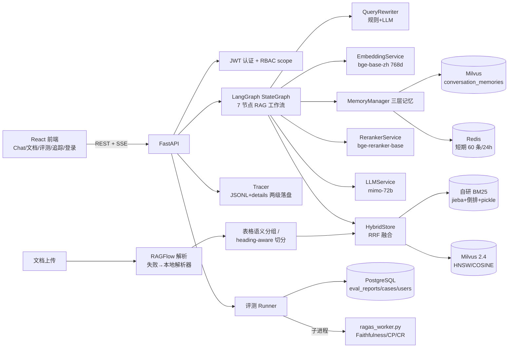
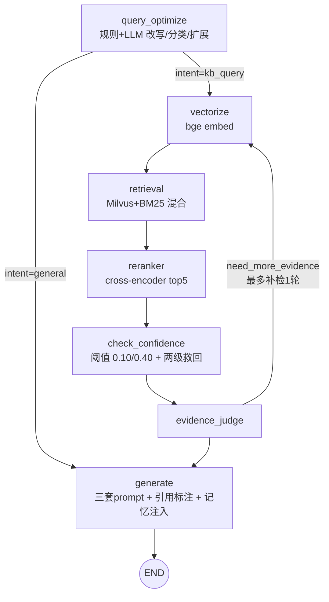

# LangGraph RAG 知识库系统 — 技术分析（代码级核实版）

> 生成日期：2026-09-25
> 分析方法：通读 `backend/app` 全部核心模块 + `frontend/src` + 部署配置，所有结论均以**当前代码**为准，与 README/CLAUDE.md 不一致处在 §8 专门勘误。
> 配套文档：[02-组内分享.md](./02-组内分享.md)（讲稿）、[03-面试准备.md](./03-面试准备.md)（题库）

---

## 1. 项目概览

| 维度 | 数据 |
|---|---|
| 定位 | 面向化工/法规领域的企业级 RAG 知识库问答系统 |
| 代码规模 | 后端 + 前端约 15,000 行（Python ~80 文件 / TS+TSX 29 文件） |
| 后端 | FastAPI + LangGraph StateGraph + OpenAI SDK（小米 mimo-72b） |
| 前端 | React 18 + TypeScript + Vite + Ant Design 5 + Zustand |
| 存储 | Milvus 2.4.17（向量）+ 自研 BM25（关键词）+ PostgreSQL 15（评测/用户）+ Redis 7（会话） |
| 模型 | Embedding: bge-base-zh-v1.5 (768d)；Reranker: **bge-reranker-base**；LLM: mimo-72b（主）/ mimo-v2.5-pro（快） |
| 文档解析 | RAGFlow（主）→ 本地解析（PyMuPDF/python-docx/pandas + PaddleOCR/Tesseract）兜底 |
| 部署 | docker-compose 9 服务 + K8s Kustomize（含 CronJob 定时评测） |
| 特色能力 | 三层对话记忆、RBAC 文档权限、自动化评测（8 指标 + 质量门禁）、全链路追踪（火焰图）、表格语义切分 |

### 模块地图

```
backend/app/
├── agents/       LangGraph 工作流（graph.py 图定义 / nodes.py 节点 / state.py 状态 schema）
├── api/          REST 层（chat/documents/evaluation/auth/tracing/scopes/health/resilience）
├── services/     LLM/Embedding/Reranker/查询优化/记忆/引用/会话/RAGFlow客户端
├── vectorstore/  hybrid_store(Milvus+BM25 融合) / bm25_index(手写倒排) / hnsw_index / shared_store
├── tools/        7 种格式解析器 + table_processor(表格语义分组) + text_splitter(heading-aware)
├── evaluation/   runner(三阶段并发) / metrics / llm_judge / gate / ragas_evaluator / case_generator / report
├── tracing/      tracer(ContextVar+span树+异步落盘) / checkpointer
├── resilience/   circuit_breaker / timeout_controller / resilience_manager / executor（统一执行器，LLM+Milvus+BM25 已接线）
├── crawler/      法规爬虫 + 版本管理 + 调度
└── core/         config / security(JWT+bcrypt) / database / model_config
backend/ragas_worker.py   RAGAS 评分子进程（隔离 segfault）
```

---

## 2. 总体架构



**分层职责**：
- **API 层**（`api/`）：认证、参数校验、SSE 流式、根 span；依赖容器为模块级懒加载单例 `get_deps()`（chat.py:28-169）。
- **编排层**（`agents/`）：LangGraph 状态机，条件路由 + 迭代补检索。
- **能力层**（`services/` + `vectorstore/` + `tools/`）：模型调用、检索、解析，全部通过 `asyncio.to_thread` 把同步重活（torch/pymilvus/jieba）挪出事件循环。
- **质量层**（`evaluation/` + `tracing/`）：离线评测门禁 + 在线链路观测。

---

## 3. 核心链路一：文档入库管线

`POST /api/documents/upload`（documents.py:262-355）→ 立即返回 `processing`，后台任务异步处理：

```
上传 → ①扩展名白名单(8种)+scope权限校验 → ②读文件(50MB上限)+md5前12位=file_hash
     → ③同hash+filename判重传：复用doc_id从checkpoint断点恢复
     → ④写doc_scopes绑定 + background_tasks(_process_document)

_process_document (documents.py:145-204):
  RAGFlow优先解析(.json除外) ──失败──▶ 本地 _parse_file 兜底 (RAGFLOW_FALLBACK_TO_LOCAL)
  → 先 delete_by_doc_id 清旧向量（防新旧chunk并存）
  → _index_chunks: 批量embed, chunk_id = md5(source)[:8]_{idx}_{uuid6}, content截65535, 入Milvus
  → metadata 置 ready → 自动生成评测用例（异常不影响主流程）→ 删checkpoint

本地解析 _parse_file (documents.py:358-432):
  PDF: parse_with_checkpoint 逐页（PyMuPDF文本层 + 乱码判定→2x缩放渲染→PaddleOCR→Tesseract兜底）
       断点续传: uploads/checkpoints/{md5_12}.json 记录 completed_pages
  → SmartTextSplitter(chunk=1024, overlap=100, min=100).split_by_heading
  → 重计算走 asyncio.to_thread(asyncio.run, coro) 防阻塞事件循环
```

**表格语义行分组**（table_processor.py，四个解析器统一委托）：
1. 前提 ≥4 行才尝试分组。
2. **Pass1** 表头关键词匹配（编号/名称/类别/客户/订单号…），且列基数满足 `2 ≤ cardinality ≤ n//3`，多候选取基数最低者。
3. **Pass2** 纯最低基数启发式；都失败 → 固定行数切分。
4. 每组一个 chunk：**表头重复注入**（每块独立生成完整 markdown 表头，保证任意 chunk 被单独检索到时自带语境）+ 组标签写入 `section_title` + 自然语言前缀「以下数据为{组}的{n}条记录」。
5. 超大组（>2048 字符且 >20 行）按 20 行子切分，标签「{组}(第N部分)」。
6. 另生成 `table_nl_description`（前 10 行的自然语言描述）——生成回答时**优先用它替代 markdown 表格**（citation_service.py:53-56），防 LLM 对表格过度推断。

**文本 heading-aware 切分**（text_splitter.py）：table/image 直通；≤1024 字符直通；超长先按 `\n\n+` 段落切 → 退化 `\n` → 仍超长退**句子边界**（逐字符扫 `。！？.!?\n`）；段落累积超限 flush 并携带 100 字符 overlap（overlap 用 rfind 对齐到句读，找不到整段保留）。

**入库后自动生成评测用例**（case_generator.py）：取最佳可用模型 temperature=0.3，每文档最多 10 条，chunk 截 8000 字符喂 LLM，`layer="document"`、`expected_source=文件名`；旧用例先 `mark_stale_by_doc_db` 标失效，删除文档同样标 stale——用例生命周期与文档闭环。

---

## 4. 核心链路二：查询链路（LangGraph）

### 4.1 图结构

7 节点 + 2 条件路由（graph.py:155-179）：



**State**：`StateGraph(dict)`（graph.py:153）——state.py 定义了 `RAGState` TypedDict 但**未绑定到图**，仅作 schema 文档；状态合并靠 wrapper 手工 `{**state, **updates}`（graph.py:141）。字段涵盖：查询侧（optimized_query/intent/keywords/expanded_queries/sub_queries）、权限侧（allowed_doc_ids/user_visible_scopes）、检索侧（raw_results/filtered_results/retrieval_confident）、迭代侧（iteration_count/need_more_evidence）、生成侧（context/answer/citations）。

**节点 wrapper**（graph.py:98-143）：每个节点被统一包裹——注入依赖 `state["_deps"]`、开 tracer span（`_NODE_SPAN_MAP`）、设置日志 task_id 上下文、`extract_span_outputs` 生成前端预览（retrieval/reranker 取前 5 条、content 截 500 字符，供 SSE step 事件推送）。

### 4.2 关键节点实现（nodes.py）

| 节点 | 逻辑 | 关键数字 |
|---|---|---|
| query_optimize (:53-101) | `query_rewriter.optimize()`：正则粗分意图 → LLM 单次调用完成改写+路由+比较类子查询分解；异常兜底原 query + intent=kb_query | sub_queries 去重取前 5 |
| vectorize (:104-120) | `embed_query(optimized_query)`，失败置 None 不中断 | 768d，query 侧加 BGE 检索指令前缀 |
| retrieval (:123-240) | RBAC：allowed_doc_ids 空 set 直接短路。有 sub_queries → 主查询 top_k=10 + 每子查询 top_k=8 **并行 gather**；否则单查询 top_k=20；结果 <3 条时用最多 2 个 expanded_queries 各 top_k=5 补查；按 chunk_id 去重、合并 accumulated_results | Milvus limit 内部再 ×2 |
| reranker (:537-575) | cross-encoder 对全部候选打分降序截断；服务不可用/异常 → 原样透传 | top_k=5，max_length=512，batch=16 |
| check_confidence (:578-634) | 见 4.3 | 阈值 0.10（reranker 分）/ 0.40（向量分回退） |
| evidence_judge (:637-661) | 结果空且第一轮 → need_more_evidence=True 触发回边（清 query_vector 强制重嵌重检）；第二轮仍空 → 放行 generate 兜底 | 最多补检 1 轮 |
| generate (:373-485) | 三套 prompt 按场景选择 + 记忆注入 + RBAC 越权提示 + 工具调用循环 | max_rounds=2 |

### 4.3 置信度判定与兜底（本项目最精细的一段逻辑）

```
迭代轮(iteration_count>0) → 直接置 True（防止循环）
结果空 → False
有 reranker_score>0 → 阈值 0.10（注释：表格/短文本 cross-encoder 天然低分）
否则回退 vector_score → 阈值 0.40
低于阈值 → 两级救回：
  ① 指代词检测（"前面提到/那个/这位"等词表）→ 仍走知识库（LLM 结合历史理解）
  ② 实体精确命中：jieba 分词去疑问词停用表得实体候选，
     若在 top5 结果 content 中逐字出现 → 仍走知识库
最终低置信 → generate 用 GENERAL_PROMPT 以通用知识回答，
  强制尾注「以上内容来自通用知识，非知识库文档」
```

**RBAC 越权探测提示**（nodes.py:298-333）：检索为空时，不带权限过滤 top_k=3 探测一次，若命中越权文档，把 scope 翻译成部门显示名，在答案尾部注入「💡 您询问的内容可能属于「X」部门的资料…」——**只泄露 scope 名不泄露内容**，兼顾安全与体验。

### 4.4 生成与引用

三套 prompt（nodes.py:243-295）：
- `RAG_PROMPT_WITH_CITATION_AND_TIME`：引用格式 `[来源N: 文件名, 第M页]`；法规必须注明发布/生效日期与知识库更新时间；查不到必须明说「知识库中未找到相关信息」。
- `GENERAL_PROMPT`：通用问答，禁编造数据/伪造来源。
- `COMPARISON_PROMPT`：比较类——先分实体列信息 → 对比 → 明确结论。

上下文拼装（citation_service.py:30-58）：每 chunk 包成 `--- [来源i: file, 第p页，发布日期，生效日期，知识库更新时间，版本] ---\ncontent`；table 类型优先 `table_nl_description`。

**引用对齐靠位置索引而非文本匹配**：格式化时按 rerank 后顺序 1-based 编号注入 `[来源i]`；解析时正则 `\[来源(\d+)(?::\s*(.*?))?\]` 扫答案，校验范围后 `source_chunks[n-1]` 取回 chunk，带出 chunk_id/source_file/page/content。

**记忆注入**：有 memory_manager + session_id 时改走 `build_context`（memory_manager.py:301-361）——system prompt 嵌入长期记忆召回 + 格式化对话历史（最近 12 条、每条截 200 字符），kb_context 以「## 参考资料」追加；messages = [system] + 最近 12 条原始消息 + 当前问题。

### 4.5 接口层（api/chat.py）

- **同步 `/query`**（:236-362）：task_id/session_id = uuid4[:8]；根 span `chat_query` 包住 `graph.ainvoke`，使全部节点 span 成为其子节点；citations 截前 10 条；graph 为 None 或异常时**返回 200 + 兜底 ChatResponse**（不抛 500）。
- **SSE `/query/stream`**（:414-517）：`graph.astream()` 逐节点推送。事件格式 `data: {json}\n\n`，三类：`step`（每节点完成，携带 extract_span_outputs 预览）、`done`（answer+citations+trace_id 一次性给出）、`error`。**是节点级流式，非 token 级**。
- **fire-and-forget 记忆提取**：响应返回后 `asyncio.create_task(memory_manager.extract_and_store(...))` 不阻塞（:330-333/:490-492）。

### 4.6 LLM 服务（llm_service.py）

`openai.AsyncOpenAI`，temperature=0.7、max_tokens=4096、**显式 timeout=60s**（注释：SDK 默认 600s 会挂死）。四方法：generate / chat / generate_with_image（base64 多模态，用于图片 OCR 失败后的 LLM 描述）/ chat_with_tools（function calling，被 generate 节点的工具循环使用，max_rounds=2）。无重试/退避；返回 usage 供 tracer 记 token。

---

## 5. 检索层深拆

### 5.1 Milvus（hybrid_store.py + hnsw_index.py）

- Collection `document_chunks`，15 字段：`chunk_id` VARCHAR(64) PK、`vector` FLOAT_VECTOR(768)、`content`(65535)、`source_file`/`file_type`/`page_number`/`line_start`/`line_end`/`chunk_index`/`content_type`/`section_title`/`table_nl_description`/`created_at`/`doc_id`/`status`(默认 active)。
- **HNSW：M=32、efConstruction=256、ef_search=128、metric=COSINE**（config.py:90-93）。四个过滤字段（source_file/content_type/doc_id/status）另建 TRIE 标量索引。
- 查询表达式：基础 `status == "active"`；RBAC 追加 `AND doc_id in [...]`（`_milvus_escape` 转义 `\` 和 `"` 后直接拼入，此处用法正确）。
- 启动自检：旧 schema 缺 doc_id/status → drop 重建；`_check_kb_consistency` 在向量库空但 BM25 有数据时报 error（主动发现两库不一致）。
- ✅ `delete_by_file`/`delete_by_doc_id`/`query_by_file` 曾存在**双重引号缺陷**（`_milvus_escape` 已含引号又外包一层 → 非法表达式 + 异常被吞 → 删除静默失败），2026-09-25 已修复：统一走 `_build_eq_expr` 助手，删除失败向上抛，documents.py 删除 API 失败即中止（500）。回归测试 test_p0_fixes.py。

### 5.2 自研 BM25（bm25_index.py）

**纯手写倒排索引，非 rank_bm25 库**：
- 结构：`inverted_index: Dict[token, List[(doc_id, tf_norm)]]`，k1=1.5、b=0.75。
- 分词：jieba.cut（ImportError 退化正则 `[一-龥a-zA-Z0-9]+`）；过滤 len<2、约 40 个内置中文停用词、纯数字。
- 打分：idf = `log((N-df+0.5)/(df+0.5)+1)`（Robertson 非负变体）；tf_score = `tf_norm*(k1+1)/(tf_norm+k1*(1-b+b*dl/avgdl))`。注意存的是**归一化 tf（count/doc_length）**而非原始词频，属 BM25 变体。
- **容灾设计**：`doc_stats` 保存 content 前 4000 字——向量库失效时 BM25 侧仍能回填正文支撑 rerank/引用（hybrid_store.py:310-312）。
- 持久化：pickle 全量 dump，**先写 `.tmp` 再 `os.replace` 原子替换**。
- 增量：add 直接 append + 维护 avgdl；文档删除走 `_rebuild_bm25_index` 全量重建，用 `query_iterator(batch_size=1000)` 分页拉取，**规避 pymilvus query 16384 条 limit 静默截断**。

### 5.3 混合融合（hybrid_store.py:321-415）

两路 `asyncio.gather` + `to_thread` 并行，各取 top_k×2，融合后截 top_k：

| 策略 | 公式 | 备注 |
|---|---|---|
| **RRF（默认）** | `score = Σ 1/(k + rank + 1)`，k=60，rank 从 0 起 | 无需分数归一化，鲁棒 |
| weighted | 各路按 max 归一化后 `0.6×v + 0.4×b` | 权重可配 |
| max | `max(归一化v, 归一化b)` | 未知策略名的兜底 |

### 5.4 Reranker（reranker_service.py）

- 模型 `BAAI/bge-reranker-base`（CrossEncoder），device 自动 cuda/cpu，模块级单例懒加载。
- **`_MAX_LENGTH=512` 截断 + `_BATCH_SIZE=16`**：代码注释给出实测依据——不截断时 v2-m3 支持 8192 token，20 条耗时 60s+；512 截断是精度/延迟权衡（历史上用 v2-m3 时 CPU 单次精排 17-71s，是评测最大瓶颈，后换 base 模型）。
- pairs 为 `(query, doc[:4000])`，`asyncio.to_thread(model.predict, pairs, batch_size=16)`；模型不可用/异常 → 全 0.0 降级（rerank 节点随之原样透传）。

---

## 6. 查询优化与记忆

### 6.1 QueryRewriter（query_rewriter.py）

- **双层意图**：正则/关键词粗分（问候语 regex + 通用 pattern + 30 个化工领域 kb_keywords）→ LLM 可覆盖。`general` 意图**直接短路跳过 LLM 改写/扩展**（注释标注省 ~26s）。
- **口语纠正词典**：13 组正则替换，含领域词归一（反应釜/精馏/安全阀/联锁/HAZOP）；`_basic_clean` 压空白、全角转半角、多问号合并、句尾补 `?`。
- **LLM 单次调用完成三件事**：改写 + 路由 + 比较类子查询分解（`re.search(r'\{[\s\S]*\}')` 抽 JSON）；非比较类再并行 gather 扩展查询（**3 个变体**）与关键词提取（jieba.analyse topK=5）。

### 6.2 三层记忆（memory_manager.py + memory_extractor.py + session_store.py）

| 层 | 存储 | 关键参数 |
|---|---|---|
| 短期 | Redis list `session:{id}:messages` + meta hash | max 60 条（30 轮）、TTL 86400s、pipeline 原子写（rpush+ltrim+expire）；Redis 断连回退进程内 dict |
| 长期 | Milvus 专用 collection `conversation_memories`（memory_id PK + vector，HNSW M=16/efC=128/COSINE，搜索 ef=64）+ `memories.jsonl` 元数据 | 召回 top10 → 过滤 expired → 排序分 `relevance × exp(-0.05×days) × importance` → top5 |
| 工作记忆 | `build_context` 拼装 | system prompt 注入长期记忆 + 历史（12 条×200 字符），kb_context 追加「## 参考资料」 |

- **记忆提取**（memory_extractor.py）：对话结束后异步 LLM 提取 5 类信息（偏好/决策/事实/身份/特定要求），importance 分级 0.9+/0.6+/0.3+；content>200 字丢弃、非法 type 归 fact、importance clamp [0,1]。
- **去重双保险**：md5 fingerprint 前 16 位精确去重 + 向量相似 ≥0.85 触发 LLM `merge_memories` 合并。
- **过期清理**：30 天未访问且 importance<0.3 → expired 并删 Milvus 向量。

---

## 7. 质量与可观测

### 7.1 评测体系（evaluation/）

**三阶段并发架构**（runner.py:127-187）：
1. **阶段1**：用例级 `Semaphore(EVAL_CONCURRENCY=3)` 并发问答；单用例内幻觉/一致性/Judge 三个 LLM 指标再 `asyncio.gather` 二层并发；单用例异常捕获转 error 结果不拖垮整批。
2. **阶段2**：收集全部 (question, answer, contexts)，按 `WORKER_CHUNK_SIZE=10` 切块，块间 `Semaphore(MAX_PARALLEL_WORKERS=3)` 并发（每子进程约 1GB 内存），每块一个 RAGAS 子进程。
3. **阶段3**：合并出分。权重：rule=1.0、**hallucination=1.5**、consistency=0.8、citation=1.0、judge=1.2、ragas_faithfulness=1.0、context_precision=0.5、context_recall=0.5；**失败指标直接剔除出加权**（不用中性分冒充）。单例通过：overall≥6.0 且幻觉≥6.0 且 rule≥5.0。

**分层抽样**（runner.py:102-118）：core 层永远全量（回归基线）；其他层 `random.Random(seed=20260828).sample`，默认 ratio=0.2，clamp [0.05,1.0]，API 可覆盖；固定种子保证跨次评测可复现对比。抽样前先过滤 stale 用例。

**多轮用例**：setup_questions **串行**执行（后续轮依赖前文），产出 previous_qa 喂给 MultiTurnConsistency；每用例独立 `session_id=eval_{case.id}_{HHMM%S}`；调 RAG API 用自签 `eval_runner` 服务 token，httpx timeout=240s。

**自定义指标**（metrics.py）：
- HallucinationFree = 规则子项（expected_not_contains 违禁词，命中 0 分否则 10）+ LLM 子项（contexts[:5]+question+answer，0-10 五档细则，temperature=0.1，明确「常识不算幻觉、诚实说不知道给高分」；调用失败 failed=True + 占位分，runner 剔除）。幻觉分从 avg 6.1 → 9.2 的调优路径：content_preview 100→500 字符、新增完整 content 字段、放宽 prompt。
- CitationAccuracy：纯规则，正则提取文内引用 + expected_source 子串匹配。
- MultiTurnConsistency：有历史时 LLM 判矛盾，返回 contradictions 列表。
- LLMJudge 6 维度（llm_judge.py）：accuracy=1.5、completeness=1.2、relevance=1.0、clarity=0.8、citation=1.0、hallucination=1.5。

**质量门禁**（gate.py）：min_overall=7.0、min_hallucination=7.0、min_citation=6.0、max_single_fail=0；有 baseline 时逐 case 回归检测（diff<-0.5 记回归）。五项串联，reasons 为空才 PASS。

**RAGAS 子进程隔离**（ragas_evaluator.py + ragas_worker.py）——本项目最有故事性的工程决策：
- **根因**：主进程（uvicorn + paddle/torch 已加载）内 `import ragas` 触发运行时冲突 **segfault**。
- **方案**：评分全部放独立子进程，stdin/stdout JSON 通信；worker 内 `DummyEmbeddings`（768 维全 0 向量桩）+ `TRANSFORMERS_OFFLINE=1`/`HF_HUB_OFFLINE=1` 阻止间接加载 torch/HF（三指标 Faithfulness/ContextPrecision/ContextRecall 均为纯 LLM 指标，不需真实向量）。
- **三重降级**：`asyncio.wait_for(timeout=600s)` 超时 kill；returncode≠0（segfault 为负值）记失败，截 stderr 末 500 字节；连续失败 3 次进程内自动停用（指标记 0，重启恢复）。`_safe_float` 把 NaN/Inf 归 0（NaN 是 truthy，`or 0.0` 挡不住——细节意识）。
- **实测效果**：core 层 10 条用例 45.3 min → 17.7 min（2.6x）。

### 7.2 链路追踪（tracing/tracer.py）

- **ContextVar 替代 threading.local**：`_trace_id_var` + `_span_stack_var`（**不可变 tuple**），asyncio 下按 Task 隔离，并发请求不再互相覆盖 trace_id/span 栈；start/end 记录 token 精确 reset。
- **span 树**：start_span 为 contextmanager，parent=stack[-1]、depth=len(stack)，链路从扁平列表变真树；异常标 error 后 re-raise。
- **异步落盘**：单线程 `ThreadPoolExecutor(trace-persist)`，进程退出中 submit 抛 RuntimeError 时降级同步写保数据不丢。
- **两级存储**：每日摘要 JSONL `logs/traces/traces_YYYY-MM-DD.jsonl`（去 spans、answer 截 200）供列表；`details/{trace_id}.json` 全量供详情/火焰图 O(1) 直读；内存 history 上限 1000。
- **前端火焰图**（FlameGraph.tsx）：按 depth 分行、start_time 算 left/width，span_type 配色；计算**自身耗时**（总耗时 − 直接子 span 和）区分「自己慢」vs「下游慢」——reranker 这类纯推理瓶颈自身占比 100%；老数据兼容（无 depth 时从父子关系推断，推断不出退化第 0 层）。
- **历史脏数据佐证修复有效**：修复前 33/185 条（18%）存在平级 span 时间重叠（LangGraph 节点串行不可能重叠，是 threading.local 并发串扰痕迹）；修复后新数据零重叠。
- 测试：`backend/tests/test_tracing.py` 5 用例（嵌套/并发隔离/异常/落盘/关闭降级）。

### 7.3 容错层现状（resilience/）✅ 已接线

- 熔断器状态机完整（CLOSED→连败5→OPEN→60s 惰性转 HALF_OPEN→成功1次 CLOSED/失败1次 OPEN），超时控制 `asyncio.wait_for`，指数退避重试（base 1s、max 30s、factor 2、jitter）。
- **接线方式**：`resilience/executor.py` 统一执行器 `ResilienceExecutor`，提供 `execute_async`（LLM 调用，带重试+熔断）和 `execute_sync`（Milvus/BM25 搜索，带重试+熔断）。`llm_service._create_completion` 所有 LLM 调用走 `execute_async`；`hybrid_store._vector_search` 和 `_bm25_search` 走 `execute_sync`。`api/resilience.py` 暴露状态查询/重置/强制开启 API。
- `can_execute()` 曾存在**必然死锁**（持锁再调加锁的 state property，Lock 不可重入）及半开配额只清零不递增的问题，2026-09-25 已修复（提取锁内 `_resolve_state` 共用 + HALF_OPEN 真实占用配额）。
- 测试：`backend/tests/test_resilience_wiring.py` 8 用例（成功/瞬态重试/非瞬态不重试/熔断快失败/同步熔断/LLM 重试/LLM 熔断/API 状态查询）。

### 7.4 安全（core/security.py + api/auth.py + api/scopes.py）

- **JWT**：python-jose HS256，payload 仅 {sub, exp}，24h；`JWT_SECRET_KEY` 为空时进程内随机生成（重启全失效，多 worker 部署互不认）。
- **bcrypt 直用而非 passlib**：passlib 1.7.4 与 bcrypt≥4.1 不兼容（hash 时直接 ValueError，实测踩坑）；gensalt(rounds=12)；密码 UTF-8 后截断 72 字节（bcrypt 上限）。
- **首次注册开放**：`/register` 仅当 users 表为空时开放，首个用户自动绑 admin，之后 403 关闭。
- **RBAC**：doc_scopes 表绑定文档与 scope；请求级 `CurrentUser`（角色+可见 scope）注入检索过滤（Milvus `doc_id in [...]`）；非 admin 只能上传可见 scope。
- ✅ 「查库无果的用户名回落默认 admin」的越权通道 2026-09-25 已修复：`SERVICE_ACCOUNTS` 显式白名单承载 eval_runner；幽灵用户名 403；`get_visible_scopes` 对未知角色返回 `[]`（无权限）而非 `None`（admin 语义）；CurrentUser 默认值改最小权限；AUTH_ENABLED=False 保留显式放行。

### 7.5 前端（frontend/src）

5 页面：ChatPage（SSE 流式 + step 事件展示每节点进度）/ DocumentPage（上传+进度轮询+chunk 查看）/ EvaluationPage（报告列表+对比）/ RecordPage（trace 抽屉，Tabs 火焰图/执行步骤，按 depth 缩进）/ LoginPage。状态：Zustand 5 store（auth 持久化 localStorage）；axios 拦截器注入 token + 401 自动跳登录；路由守卫 RequireAuth。测试：vitest + jsdom + @testing-library，3 个测试文件 10 用例（authStore / client 拦截器 / FlameGraph）。

---

## 8. 文档与代码不一致（勘误）

| # | README/CLAUDE.md 说法 | 代码实际 | 位置 |
|---|---|---|---|
| 1 | Reranker = bge-reranker-**v2-m3**，待优化项「换 base」 | 默认已是 **bge-reranker-base**（待优化项 2 实际已完成一半，文档未更新） | config.py:127, reranker_service.py:45 |
| 2 | Docker Compose **8** 服务 | 实为 **9** 服务（milvus/redis/postgres/mysql/es01/minio/ragflow/backend/frontend） | docker-compose.yml |
| 3 | CLAUDE.md「Milvus 表达式注入已加固」 | `_milvus_escape` 本身正确，但 3 处调用点**双重引号**反而生成非法表达式（见 §9 P0-1） | hybrid_store.py:427/445/466 |
| 4 | README 评测维度表只列 Judge 6 维度权重全 1.0 | llm_judge 实际权重 1.5/1.2/1.0/0.8/1.0/1.5；总评分还含 rule/consistency/ragas 共 8 项加权 | llm_judge.py:40-49, runner.py:257-283 |
| 5 | compose 中 postgres 容器建库 `langgraph_checkpoints` | backend 环境覆盖为 `chemical_rag`，容器并不会自动建这个库（依赖迁移脚本/宿主机 PG） | docker-compose.yml:50 vs :191 |

---

## 9. 问题与风险清单（静态审查，按优先级）

### P0 — 功能性缺陷（✅ 全部已于 2026-09-25 修复，回归测试 `backend/tests/test_p0_fixes.py`，全量套件 101 passed）

| # | 问题 | 位置 | 状态与修法 |
|---|---|---|---|
| 1 | **Milvus 删除/查询表达式双重引号**：`_milvus_escape` 已返回带引号串，调用点又外包一层引号 → `source_file == ""x""` 非法表达式；异常被 `except` 吞掉仅 log error，**删除静默失败**，可能残留孤儿 chunk 造成检索重复；documents.py「删除失败必须中止」的保护也因异常被吞而失效 | hybrid_store.py, memory_manager.py | ✅ 新增 `_build_eq_expr` 助手统一拼接，4 处调用点改用；delete_by_file/delete_by_doc_id 失败向上抛；delete_document API 失败中止（500）不再继续删元数据 |
| 2 | **未入库用户名自动获得 admin 权限**：JWT 验签通过但 DB 查无此人 → 回落 `CurrentUser(role_id="admin", scope_ids=["all"])`。eval_runner 服务 token 依赖此行为，但任何持有效签名 token 的幽灵用户名同样获得全量权限 | auth.py, permission_service.py | ✅ `SERVICE_ACCOUNTS` 显式白名单（默认 ["eval_runner"]，授予 service 角色）；幽灵用户 403；get_visible_scopes 对 None 角色返回 []；CurrentUser/MeResponse 默认值改最小权限；AUTH_ENABLED=False 保留显式放行 |
| 3 | **熔断器 can_execute 必然死锁**：持 `self._lock` 再调 `state` property 二次加同一把不可重入 Lock。当前无调用点所以未爆，一旦按规划接入 RAG 流程即挂死请求线程 | circuit_breaker.py | ✅ 提取锁内 `_resolve_state()` 供 state property 与 can_execute 共用；顺带修复 `_half_open_requests` 只清零不递增（半开限流形同虚设），状态迁移时清零 |

### P1 — 正确性/健壮性

| # | 问题 | 位置 |
|---|---|---|
| 4 | ~~`asyncio.create_task` 记忆提取无引用保存~~ ✅ 已修复：`_spawn_background` 辅助函数（引用集合保活 + done_callback 日志异常） | chat.py |
| 5 | LLMJudge 解析失败**静默全维度给 5 分不标 failed**，与「失败指标剔除」哲学冲突，会拉低真实均分 | llm_judge.py:139-143 |
| 6 | 失败指标占位分仍写入 CaseResult 维度字段，污染 dimension_scores 平均与门禁输入（如 consistency 失败占位 10 分） | runner.py:311-313, report.py:250-253 |
| 7 | 无 contexts 且无 LLM 时幻觉分默认满分 10——检索失败反而得高幻觉分 | metrics.py:99-102 |
| 8 | reranker 节点**原地** sort/截断 state 中列表，raw/filtered 共享同一批 dict 引用，对 LangGraph state 有副作用 | nodes.py:561-568, 236 |
| 9 | `temperature or self.temperature`——显式传 0 会被缺省 0.7 覆盖 | llm_service.py:31/51/91 |
| 10 | BM25 同 doc_id 重复 add 不清旧 posting，df/avgdl 失真；delete O(词表) 全扫 | bm25_index.py:52-71, 96-105 |
| 11 | 长期记忆 `_rank_memories` expired 过滤后与 scores 按位配对可能错位；memories.jsonl 全量重写无锁，与 Milvus 双存储可能失同步；token_budget=1000 定义未用 | memory_manager.py:88, 211-228, 481-508 |
| 12 | evidence_judge 补检索轮用**同一 optimized_query** 重检，除首轮 embedding 失败外几乎必然再次为空，补检价值存疑 | nodes.py:648-661 |
| 13 | `/chat/history`、`/sessions`、`/memories/stats` 无 get_current_user 鉴权，session_id 仅 8 位可枚举 | chat.py:520-566 |
| 14 | 临时 JWT secret 多 worker 部署各进程不同，token 跨 worker 验证失败 | security.py:47-49 |
| 15 | metadata.json 无锁读改写，并发上传互相覆盖 | documents.py:53-99 |

### P2 — 死代码/工程债

| # | 问题 | 位置 |
|---|---|---|
| 16 | `create_agent_graph` 的 tool_call 节点无任何边接入；`should_use_tools` 导入未用 | graph.py:201, nodes.py:669 |
| 17 | ~~RAGState TypedDict 未绑定图~~ ✅ 已修复：`StateGraph(RAGState)` + `StateGraph(AgentState)`，state.py 补齐 `_deps`/`tools_to_call`/`tool_results` | graph.py / state.py |
| 18 | Checkpointer 初始化后未传入 `compile()` | chat.py:49-54, graph.py:181 |
| 19 | ~~resilience 整体未接线~~ ✅ 已修复：`executor.py` 统一执行器，LLM/Milvus/BM25 均走 execute_async/sync + 熔断器，api/resilience.py 暴露真实状态 | executor.py, llm_service.py, hybrid_store.py |
| 20 | `GateConfig.regression_threshold` 死配置，实际阈值硬编码在 report.py | gate.py:21, report.py:279/286 |
| 21 | text_splitter `separators` 死参数；citation `validate_citations` 未被生成链路调用；parse_citations 不去重、裸 except | text_splitter.py:13-17, citation_service.py:49/60-84 |
| 22 | 评测每问新建 httpx client 无连接复用；`ragas_map` 以 `id()` 为键依赖对象存活期 | runner.py:162/374 |
| 23 | ~~docker-compose 明文弱密码 + 绑定个人路径~~ ✅ 已修复：所有密码 `:?` 必填插值 + `.env.example` 模板 + HF_CACHE_DIR 命名卷默认值 | docker-compose.yml, docker/.env.example |
| 24 | ~~无 CI / 容器无 pytest / 前端无测试~~ ✅ 已修复：`.github/workflows/ci.yml`（backend pytest + frontend vitest + compose-config）；Dockerfile 多阶段 dev target 含 pytest；vitest + @testing-library 10 用例 | .github/workflows/ci.yml, backend/Dockerfile, frontend/vitest.config.ts |
| 25 | ~~image_processor 每实例重新初始化 OCR~~ ✅ 已修复：模块级 `_PADDLE_OCR_INSTANCE` 单例；临时文件异常路径泄漏仍存在 | image_processor.py |

---

## 10. 技术选型理由与权衡总结

| 决策 | 选择 | 理由 / 放弃的替代方案 |
|---|---|---|
| 编排 | LangGraph StateGraph | 条件路由 + 回边（迭代补检索）用图表达最自然；纯 chain 无法表达 evidence_judge→vectorize 回边。已绑定 RAGState TypedDict 校验 |
| 向量库 | Milvus standalone | 需要标量过滤（RBAC doc_id in）+ HNSW；FAISS 无过滤/持久化弱，ES 向量能力弱 |
| 关键词检索 | **自研 BM25** 而非 ES | 部署已有 ES（RAGFlow 依赖）但为 RAGFlow 专属；自研倒排 ~300 行可控、pickle 原子持久化、可存 content 前 4000 字做容灾回填。代价：删除 O(词表)、单机 pickle |
| 融合 | RRF（默认） | 无需跨路分数归一化（向量 COSINE 分与 BM25 分量纲不可比）；weighted 保留作可调项 |
| 精排 | cross-encoder + 512 截断 | bi-encoder 精度不够；不截断 8192 token 实测 20 条 60s+ 不可接受；512 是实测折中 |
| RAGAS | **子进程隔离** | 主进程 import ragas 与 paddle/torch 运行时冲突 segfault；修依赖不可控，进程边界是最强隔离；桩 embedding 避免子进程再加载 1GB+ 模型 |
| 记忆 | Redis(短期)+Milvus(长期)+拼装(工作) | 短期要 TTL/LTRIM 天然 Redis；长期要语义召回复用 Milvus；代价：jsonl+Milvus 双写一致性 |
| 追踪 | 自研 tracer 而非 OpenTelemetry | 需求是业务级 span 树 + 前端火焰图 + JSONL 轻量落盘；OTel 栈重、导出器配置复杂。代价：无标准生态互通 |
| 密码 | bcrypt 直用 | passlib 1.7.4 与 bcrypt≥4.1 不兼容（实测 ValueError），锁 passlib 则锁死依赖 |
| 解析 | RAGFlow 优先 + 本地兜底 | RAGFlow 版面分析强；但黑盒、重依赖（mysql/es/minio），本地解析器保证可降级 |
| 评测抽样 | core 全量 + 分层抽样 + 固定 seed | 全量 45min 不可日常跑；core 保回归基线；seed 固定保证两次评测同题可比 |

---

*本文档由代码静态审查生成。P0 三项已于 2026-09-25 修复并通过回归测试（test_p0_fixes.py 10 用例 + 全量套件 101 passed）。P1/P2 中高优先级项已于 2026-09-26 全部完成：Resilience 接线（executor.py + LLM/Milvus/BM25 熔断重试）、StateGraph 绑定 RAGState、Prompt 外部化、OCR 单例、fire-and-forget 引用保活、compose 密码必填+HF 命名卷、CI（.github/workflows）+ 容器 pytest + 前端 vitest（10 用例）。剩余 P1（评测指标占位分/BM25 重复 add/记忆双写一致性等）和 P2（死代码/临时文件泄漏/lifespan 迁移等）仍待处理。建议在真实 Milvus 环境补一次删除→重传的端到端验证。全量后端套件 111 passed + 1 skipped，前端 10 passed。*
