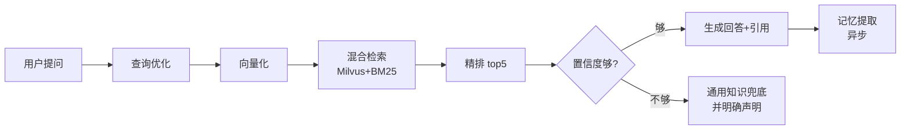
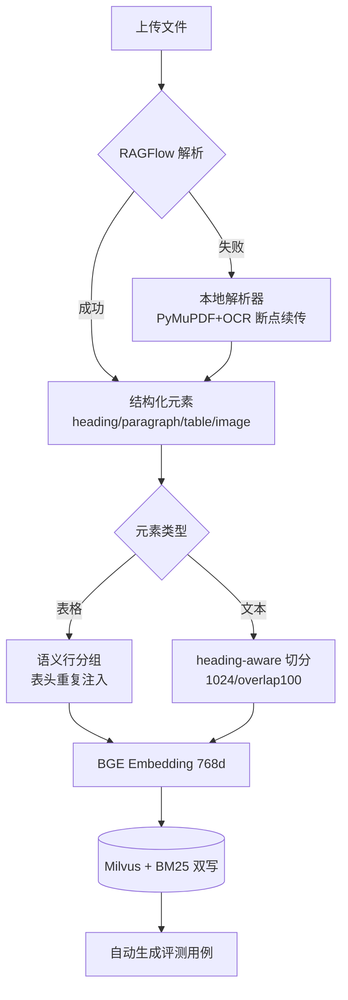
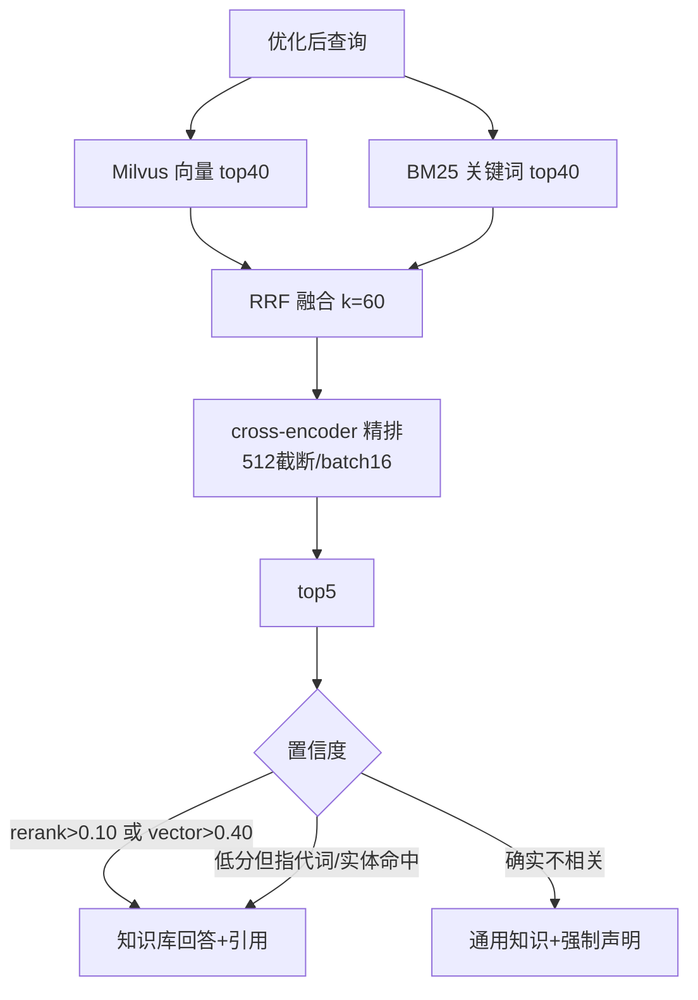
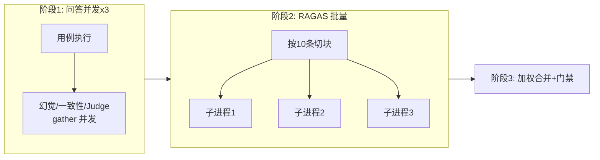

# 组内分享讲稿：用 LangGraph 从零搭一个企业级 RAG 知识库

> 形式：45-60 分钟现场分享 + Q&A
> 受众假设：有后端基础（懂 API/数据库/异步），**不熟 RAG / 向量检索 / LLM 工程**
> 讲稿用法：每节含「时间预算 / 讲述要点 / 口播提示（可直接照读的话术）/ 配图」；mermaid 图可提前渲染进 PPT
> 事实依据：全部内容经代码级核实，出处见 [01-技术分析.md](./01-技术分析.md)

---

## 0. 开场：一个问题钩子（3 min）

**讲述要点**
- 先演示或口述一个真实失败场景：把公司文档丢给 ChatGPT 问「我们 XX 反应釜的联锁值是多少」——它会一本正经地编一个数。
- 抛出本次分享要解决的三个问题：① 怎么让 LLM 只用你的文档回答；② 怎么知道它没编；③ 编了怎么追责（引用溯源）。

**口播提示**
> 「LLM 什么都懂，但不懂你们公司。RAG 做的事情一句话：**开卷考试**——答之前先翻书，把翻到的那几页塞进卷子里，并且要求它写上『答案出自第几页』。今天讲的就是我们怎么把这场开卷考试从『能考』做到『考得好、可判卷、可复盘』。」

**配图**：无，纯口播 + 一张失败回答截图（如有）。

---

## 1. 全景：系统长什么样（8 min）

**讲述要点**
- 一句话定位：化工/法规领域知识库问答，前端 React、后端 FastAPI + LangGraph，Milvus 存向量、Redis 存会话、PG 存评测。
- 规模感：约 1.5 万行代码，9 个 docker 服务，文档解析→检索→生成→评测→观测全链路自研可控。
- 强调两个「不寻常」的设计，埋下后面的伏笔：
  1. 检索是**三级的**：向量 + BM25 双路召回 → RRF 融合 → cross-encoder 精排；
  2. 有一套**自动化评测 + 质量门禁**，答案质量是能被数字度量的。

**口播提示**
> 「大家看这张图，先看主线就行：问题进来，先『改写问题』，再『两路找资料』，找完『精挑 5 条』，然后『判断资料够不够』，最后『带着资料生成答案』。这条主线在代码里就是 LangGraph 的 7 个节点，后面每一站我们都停下来看。」

**配图**（mermaid，直接可用）：

---

## 2. 文档怎么变成「可检索的知识」（10 min）

**讲述要点**
1. **解析双保险**：RAGFlow（版面分析强，但拖着 mysql/es/minio 三个依赖）优先，失败自动降级本地解析器（PyMuPDF/python-docx/pandas）。扫描件判定三规则：文本 <5 字符 / CJK 占比 <5% / 控制字符占比 >10% → 2 倍缩放渲染 → PaddleOCR → Tesseract 兜底。
2. **切分是 RAG 的第一生死线**。两个自研策略：
   - **表格语义行分组**：一张 500 行的客户订单表，按固定 512 字符切会把表头和数据行切开，检索到「张三 | 100 | 2026-01」这种碎片 LLM 根本不知道 100 是什么。我们的做法：自动检测「分组键」（优先匹配表头关键词如 客户/类别/订单号，退化到最低基数列），按业务字段分组，**每个 chunk 重复注入完整表头** + 组标签前缀「以下数据为客户张三的 12 条记录」。
   - **heading-aware 文本切分**：chunk 1024 / overlap 100，按段落边界切，超大段落退句子边界，overlap 对齐到句读。
3. **断点续传**：500 页 PDF 解析到 300 页挂了，checkpoint 文件记录 completed_pages，重传从 301 页继续。
4. **入库即出题**：文档入库后自动用 LLM 生成最多 10 条评测用例（expected_source=文件名），删除文档时用例标 stale——评测集跟知识库同生命周期。

**口播提示**
> 「为什么表头要重复注入？因为检索是**按 chunk 独立召回**的——一个 chunk 被捞出来的时候，它必须自己就是完整的。这就像把一本书撕成卡片放图书馆，每张卡片都得自带书名和章节名，否则读者拿到卡片也不知道在说什么。」

> 「切分策略没有银弹，我们的判断标准就一条：**被单独检索到的 chunk，能不能不靠邻居独立回答一个具体问题**。表格按业务分组满足这条，固定长度切分不满足。」

**配图**：

---

## 3. 检索的艺术：三路召回与两级兜底（12 min）——本次分享技术含量最高的一节

**讲述要点**
1. **为什么要双路召回**：向量检索懂语义（「反应釜超温」能匹配「反应器温度超限」）但对**精确编号/型号不敏感**（「GB/T 1234」这种 token 向量模型分不清）；BM25 正好相反。两路各取 top_k×2，`asyncio.gather` 并行。
2. **RRF 融合**（默认策略）：`score = Σ 1/(60 + rank + 1)`。只认排名不认分数——因为向量 COSINE 分和 BM25 分量纲完全不可比，归一化融合容易被单路极端分带偏。一行公式，工程上极稳。
3. **cross-encoder 精排**：召回是「各自编码再比距离」（bi-encoder，快但糙），精排是「query 和 doc 拼一起过模型」（cross-encoder，准但慢），所以只对融合后的几十条做。模型 bge-reranker-base，**输入截断 512 token、batch=16**——这是实测出来的：不截断时 20 条要 60s+，线上不可接受。
4. **置信度双阈值 + 两级救回**（最有意思的防御性设计）：
   - reranker 分阈值 **0.10**（不是 0.5！因为表格/短文本 cross-encoder 天然打低分），向量分回退阈值 0.40；
   - 低于阈值先别急着兜底：① 问题含指代词（「前面提到的那个」）→ 仍走知识库，让 LLM 结合历史理解；② jieba 抽实体，若实体在 top5 内容中**逐字命中** → 仍走知识库。
   - 真不行 → 通用知识回答，但**强制尾注声明**「以上内容来自通用知识，非知识库文档」。
5. **迭代补检索**：结果为空且是第一轮 → 回边重新向量化重检（**最多 1 轮**，防死循环）。
6. **RBAC 越权提示**：检索为空时不带权限过滤探测 top3，如果命中了用户无权看的部门文档，答案尾部提示「您询问的内容可能属于「X」部门的资料」——**只提示存在性，不泄露内容**。

**口播提示**
> 「RRF 这个公式建议大家记住，面试常考：它的全部智慧就是『不比较分数，只比较排名』。两路检索各自第 1 名的分数没有可比性，但『你在你那一路排第几』是公平的。」

> 「阈值 0.10 看起来低得离谱，对吧？这是被数据教育出来的——表格 chunk 在 cross-encoder 眼里就是低分，用 0.5 会把一半正确答案判成兜底。**RAG 系统里所有魔法数字背后都应该有一次失败的评测**。」

**配图**：

---

## 4. 让系统有记忆：三层架构（6 min）

**讲述要点**
1. **短期记忆**：Redis list，每会话 60 条（30 轮）、TTL 24h，pipeline 原子写（rpush+ltrim+expire 一把梭）；Redis 挂了回退进程内 dict 不阻断对话。
2. **长期记忆**：每轮对话结束后，**异步** fire-and-forget 让 LLM 提取 5 类信息（偏好/决策/事实/身份/特定要求），带 importance 分级（0.9/0.6/0.3），存进 Milvus 专用 collection。
   - 去重双保险：md5 指纹精确去重 + 向量相似 ≥0.85 触发 LLM 合并（「用户喜欢 A」和「用户偏好 A」合并成一条）。
   - 召回排序分 = `relevance × exp(-0.05×天数) × importance`——时间衰减是乘性的，30 天未访问且 importance<0.3 自动过期删除。
3. **工作记忆**：每次请求现场拼装——system prompt 注入长期记忆召回 top5 + 最近 12 条历史（每条截 200 字符）+ 知识库上下文以「## 参考资料」追加。

**口播提示**
> 「为什么要 LLM 提取而不是把全部历史都塞进 prompt？两个原因：token 成本和噪声。用户三天前说过一句『我负责 3 号装置』，这句话值 0.9 的 importance，每次提问都该带上；而昨天的 30 轮闲聊不值钱。**记忆系统的本质是压缩 + 遗忘曲线**，跟人脑一个思路。」

---

## 5. 拒绝玄学：评测体系与一场 segfault 战争（10 min）——最适合讲故事的一节

**讲述要点**
1. **为什么必须自动评测**：RAG 改动（换切分/换模型/调 top_k）的影响无法靠肉眼回归，必须把「答案质量」变成数字。
2. **8 个指标加权**：规则检查 1.0、幻觉 1.5（最高）、一致性 0.8、引用 1.0、LLM Judge 六维 1.2、RAGAS 三项（faithfulness 1.0 / context_precision 0.5 / context_recall 0.5）。**失败指标直接剔除出加权，不用中性分冒充**——这是评测系统的诚实性底线。
3. **幻觉分从 6.1 调到 9.2 的过程**（真实调优案例）：不是模型变强了，是**评测输入变全了**——context preview 100→500 字符、补完整 content 字段、prompt 明确「常识不算幻觉、诚实说不知道给高分」。启示：先怀疑评测器，再怀疑系统。
4. **质量门禁**：overall≥7.0、幻觉≥7.0、引用≥6.0、零单例失败、对比 baseline 无回归（单 case diff<-0.5 记回归）——五项全过才 PASS，可挂 CI/CronJob。
5. **分层抽样提速**：core 层永远全量（回归基线），其他层 20% 固定 seed 抽样——45.3 min → 17.7 min（2.6x），且两次评测抽到同一批题，可比性不丢。
6. **压轴故事：RAGAS segfault**：
   - 现象：主进程 import ragas → 整个 uvicorn 段错误退出，无 Python 异常无栈。
   - 根因：主进程已加载 paddle/torch，ragas 间接拉起的 HF 栈与之运行时冲突，C 层崩掉 Python 无法捕获。
   - 方案：**进程边界是最强的隔离**——评分全部丢进 `ragas_worker.py` 子进程，stdin/stdout 传 JSON；子进程里用**全 0 向量的桩 embedding** + 离线环境变量，阻止它再加载 1GB 的 torch 模型（三个指标都是纯 LLM 指标，根本不需要真向量）。
   - 防御纵深：600s 超时 kill、returncode≠0 记失败、连续失败 3 次自动停用降级为 0 分、NaN/Inf 全链路清洗（细节：NaN 是 truthy，`or 0.0` 挡不住，得专门写 `_safe_float`）。

**口播提示**
> 「这个 segfault 给大家的 takeaway 是：**Python 里 try/except 只能保护 Python 层的错误，C 扩展崩了就是崩了**。当你控制不了依赖的加载顺序时，别在进程内修，开子进程——崩溃半径立刻从『整个服务』缩小到『一次评分』。」

> 「桩 embedding 这个技巧值得学：先问『这个指标真的需要向量吗』——不需要。那就给个全 0 的假实现骗过框架的初始化，省掉 1GB 内存和 20 秒加载。**对抗框架最好的方式是搞清楚它到底要什么**。」

**配图**：

---

## 6. 可观测性：自研 trace 与并发串数据的侦探故事（6 min）

**讲述要点**
1. **为什么自研而不是 OpenTelemetry**：需求是业务级 span 树 + 前端火焰图 + 轻量 JSONL 落盘，OTel 栈太重。tracer 核心 ~300 行。
2. **一个真实 bug 的侦破**：trace 列表里发现 18%（33/185）的记录存在**平级 span 时间重叠**——LangGraph 节点是串行执行的，物理上不可能重叠。顺藤摸瓜：trace_id 存在 `threading.local` 里，而服务是 asyncio 的——并发请求跑在同一线程的不同 Task 上，threading.local 根本隔离不了，A 请求的 span 被记进了 B 请求的 trace。
3. **修复**：`threading.local` → `contextvars.ContextVar`（asyncio 按 Task 自动隔离），span 栈改成**不可变 tuple**（子 Task 修改不污染父 Task），start/end 记录 token 精确 reset。修复后新数据零重叠——**用旧脏数据反向验证了修复有效性**。
4. **火焰图组件**：按 depth 分行、时间轴画条，最有用的指标是**自身耗时**（总耗时 − 直接子 span 之和）——一眼区分「自己慢」还是「下游慢」，reranker 自身占比 100%，瓶颈定位不用猜。
5. 落盘异步化：单线程池后台写，进程退出时降级同步写保数据。

**口播提示**
> 「asyncio 时代记一条铁律：**线程本地存储在线程池复用线程的地方是对的，在协程里是错的**。一个线程上跑着一千个 Task，threading.local 对它们来说是同一个全局变量。用 ContextVar，asyncio 帮你按 Task 隔离。」

---

## 7. 复盘：做对了什么 / 踩过的坑 / 下一步（5 min）

**做对了（可复用的经验）**
1. 所有魔法数字都有评测数据背书（0.10 阈值、512 截断、chunk 1024）。
2. 评测先行：每次改动跑分层抽样对比，好坏用数字说话。
3. 防御性降级贯穿全链路：reranker 挂了透传、Redis 挂了内存兜底、RAGFlow 挂了本地解析、RAGAS 挂了记 0 分——**任何单点故障都不该让问答主链路 500**。
4. 可观测性是修 bug 的前提：没有 trace 就不会发现并发串数据。

**踩过的坑（诚实环节）**
1. passlib 1.7.4 与 bcrypt≥4.1 不兼容，hash 直接 ValueError → 弃 passlib 直用 bcrypt。
2. OpenAI SDK 默认超时 600s，LLM 卡顿时请求挂死 → 显式 60s。
3. 老 reranker（v2-m3, 568M）CPU 上单次精排 17-71s，是评测最大瓶颈 → 换 base 模型 + 512 截断。
4. pymilvus query 有 16384 条静默截断，BM25 重建曾悄悄丢数据 → query_iterator 分页。

**已完成（2026-09-26 更新）**
- P0 三项修复（Milvus 表达式双重引号 / 熔断器死锁 / 幽灵用户名回落 admin），test_p0_fixes.py 10 用例。
- Resilience 接线：`executor.py` 统一执行器，LLM/Milvus/BM25 走 execute_async/sync + 熔断器重试，test_resilience_wiring.py 8 用例。
- StateGraph 绑定 RAGState TypedDict；Prompt 外部化（prompts/ 包）；OCR 单例；fire-and-forget 引用保活。
- CI 自动化：`.github/workflows/ci.yml`（backend pytest + frontend vitest + compose-config 验证）+ Dockerfile 多阶段 dev target。
- 前端测试：vitest + jsdom + @testing-library，3 个测试文件 10 用例。
- compose 密码 `:?` 必填插值 + `docker/.env.example` + HF 命名卷。
- 全量后端 111 passed + 1 skipped，前端 10 passed。

**下一步（欢迎认领）**
1. reranker 上 GPU（base 模型已换，CPU 仍是评测瓶颈）。
2. 剩余 P1：历史/会话接口补鉴权、LLM Judge 解析失败改为标 failed、BM25 重复 add 清旧 posting（清单见技术分析 §9）。
3. P2 清理：lifespan 迁移、临时文件泄漏、死代码修剪。

---

## 8. Q&A 预设问题（10 min）

| 可能的提问 | 简答 |
|---|---|
| 为什么不用 LangChain 的 Retriever 全家桶？ | 需要 RBAC 过滤、双库一致性自检、content 容灾回填这些定制逻辑，自己写 300 行 BM25 + 融合比魔改框架干净。 |
| 向量库为什么选 Milvus 不选 pgvector？ | 需要标量过滤 + HNSW 调参（M=32/efC=256）+ 独立扩缩容；且 RAGFlow 依赖栈里已有。 |
| 评测用 LLM 打分，LLM 自己靠谱吗？ | ① temperature=0.1；② 幻觉评分给明确五档细则而非笼统打分；③ 规则指标（违禁词/引用匹配）不依赖 LLM；④ 失败指标剔除不冒充；⑤ 固定 seed 抽样保证同题可比。LLM Judge 有噪声，但**趋势和回归检测**是可靠的。 |
| 单机能撑多少并发？ | 瓶颈在 CPU reranker（评测并发 3 就饱和）。上 GPU 或降级 reranker 是扩容第一步；LLM 是外部 API 不占本机。 |
| 文档更新后旧向量怎么办？ | 重传复用 doc_id，先删旧 chunk（删除失败中止索引并报错，不再静默）再入新；评测用例同步标 stale。顺带一提：审查中曾发现删除表达式双重引号导致静默失败的缺陷，已修复并有回归测试（见技术分析 §9）。 |
| 为什么 SSE 是节点级不是 token 级？ | 当前 done 事件一次性给 answer；节点级 step 事件先让用户看到「正在检索/正在精排」的进度。token 级流式是下一步（llm_service 尚无 stream=True）。 |

---

## 附：分享前检查清单

- [ ] 本地 `docker compose up` 起服务，准备一个真实提问 demo（开场用）
- [ ] mermaid 图渲染进 PPT（共 5 张）
- [ ] 准备火焰图截图一张（RecordPage 抽屉，选一个 reranker 占比高的 trace）
- [ ] 准备评测报告对比截图（调优前后幻觉分 6.1 → 9.2）
- [ ] 时间不够时的删减顺序：§4 记忆 → §6 可观测性 → §2 的断点续传细节（保 §3 §5，是含金量最高的两节）
