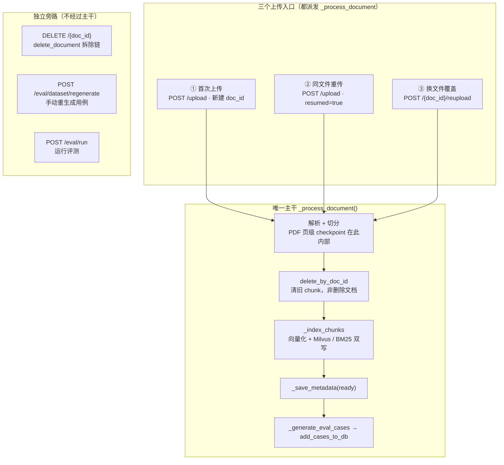
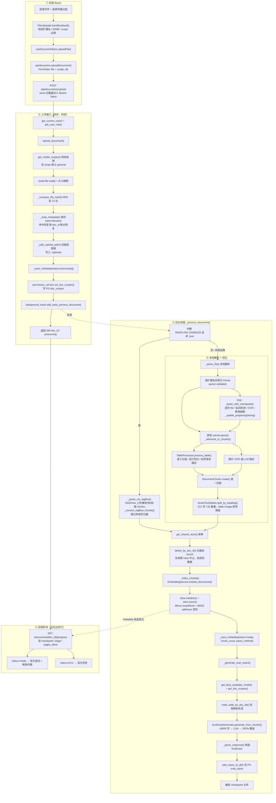
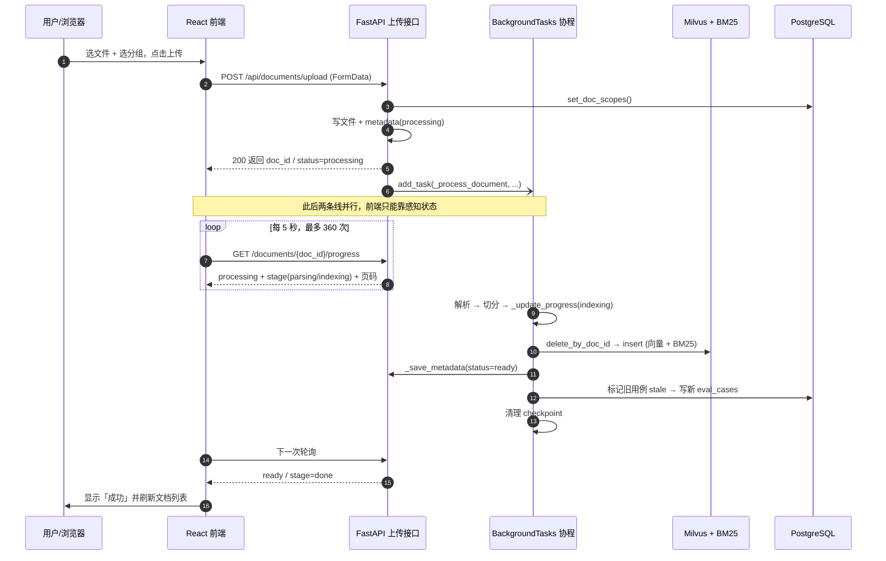

# 08 · 文档入库与测试用例生成全流程（代码级导读）

> 生成日期：2026-11-23
> 覆盖范围：从用户在页面点下「上传」，到文档被切分、向量化写入 Milvus/BM25，再到评测用例自动落进 PostgreSQL 的**完整链路**，逐方法标注文件与行号。
> 代码基准：以当前仓库代码为准；`.env` 中的开关值决定实际运行分支，与 `config.py` 默认值不一致处在 §6.1 专门说明。
> 配套文档：[01-技术分析.md](./01-技术分析.md)（整体架构）、[04-固定流程设计.md](./04-固定流程设计.md)（固定流程引擎）

---

## 0. 先读这一页

**一句话结论**：上传接口只负责「存文件 + 登记状态」并立刻返回，之后**由一个后台协程 `_process_document()` 从头包干到尾** —— 解析、切分、删旧索引、向量化入库、生成评测用例全部在这一个协程里顺序执行。因此**前端没有任何「生成测试用例」按钮**，用例是上传的副产品。

三个最常见的认知偏差，先摆在这里：

| 容易以为 | 实际情况 |
|---|---|
| 需要单独点「生成用例」 | 不需要。`_generate_eval_cases()` 在 `_process_document()` 末尾被自动调用 |
| 状态变成 `ready` 就万事大吉 | `ready` 是在用例生成**之前**写的，用例可能晚几秒甚至失败，且失败不会改变 `ready` |
| 一定会走 `SmartTextSplitter` | 只有本地解析分支会切分；RAGFlow 分支自带切分结果，直接跳过切分器 |
| 精简链里的 `delete_by_doc_id` 是「删除文件」那一步 | 它是上传主链内部「先清旧 chunk 再重建」的一步；真正的删除走独立接口 `delete_document()`，见 §1.1 |
| 「断点续传」是第三条独立链 | 它是主链内部的两个机制（同文件复用 `doc_id` + PDF 页级 checkpoint），见 §1.1 |

**怎么读这份文档**

- 只想快速理解：看 §1 速览（含 §1.1 入口总览）+ §2 全景图，5 分钟够。
- 要改代码 / 查 bug：直接跳到对应阶段（§3–§8），每阶段都有「方法 → 文件:行号 → 做了什么」的表格。
- 要核对某个方法在哪被调用：查 §附录 A 的全链路方法索引。
- 线上出问题：先看 §11 排障速查表。

---

## 1. 一分钟速览

| 维度 | 结论 |
|---|---|
| 入口 | 前端 `DocumentPage` → `FileUploader`；后端主入口 `POST /api/documents/upload`（另有 2 个入口见 §1.1） |
| 请求体 | `multipart/form-data`：`file`（二进制）+ `scope_ids`（逗号分隔字符串） |
| 响应 | 200，立即返回 `{doc_id, status: "processing", resumed, scope_ids}` |
| 后台模型 | FastAPI `BackgroundTasks`（**进程内协程**，不是 Celery / MQ，重启即丢） |
| 总控方法 | `backend/app/api/documents.py::_process_document()`（:145） |
| 处理顺序 | 解析 → 删旧 chunk → 向量化双写 → 写 `ready` → 生成评测用例 → 删 checkpoint |
| 前端感知 | 每 5 秒轮询 `GET /api/documents/{doc_id}/progress`，最多 360 次（30 分钟） |
| 用例触发 | 自动，`_generate_eval_cases()`（:207）；另有手动 API `POST /api/eval/dataset/regenerate/{doc_id}` |
| 用例落点 | PostgreSQL `eval_cases` 表，`id = doc_{doc_id}_{序号}`，`layer = "document"` |

**最精简的调用链**（记住这一行就够；括号里是容易踩坑的前提）：

```
FileUploader.handleUpload
  → uploadFile → uploadDocument → POST /api/documents/upload
  → upload_document → BackgroundTasks.add_task(_process_document)
  → _parse_file（本地分支）→ SmartTextSplitter.split_by_heading
  → delete_by_doc_id〔清旧 chunk，非删除文档〕
  → _index_chunks → initialize + insert（Milvus + BM25 双写）
  → _save_metadata(ready) → _generate_eval_cases（可能跳过）→ add_cases_to_db
```

> **读这行时的三个前提**
> 1. `delete_by_doc_id` 是主链内部「重建前清旧 chunk」的一步（`documents.py:174`），**与删除文档接口 `delete_document()`（:649）无关**，只是名字撞车；后者不经过 `_process_document`。
> 2. 只有本地解析分支才经过 `SmartTextSplitter`；`RAGFLOW_ENABLED=true` 且非 `.json` 时改走 `_parse_via_ragflow()`，且**不二次切分**（见 §6.1）。
> 3. 用例生成排在 `ready` 之后且**非必达**：LLM 未配置 / 无有效 chunk / 返回解析失败都会提前 return；中间还省了 `mark_stale_by_doc_db()`，失败只记 warning、不改 `ready`（见 §8）。

### 1.1 入口总览：三个入口，一条主干

后面章节还会出现「删除」「断点续传」「重新上传」等动作，但它们**不是三条平行的链**。准确关系是：**3 个 HTTP 入口汇入同一个后台协程**，删除与评测是独立旁路，断点续传是主干内部的机制。



| 口径 | 结论 |
|---|---|
| 能触发后台处理的入口 | 3 个：首次上传（:263）、同文件重传（同一个 :263 里的 `:299` 分支）、换文件覆盖 `reupload_document()`（:690）。**三者都调 `add_task(_process_document, ...)`**，所以是「3 入口 1 主干」，不是三条独立链 |
| 端到端业务链 | 1 条主干 + 3 条独立旁路（删除、手动重生成、运行评测，详见 §9） |
| 断点续传 | 2 处机制，均在主干内部，**不构成一条链** |

**「断点续传」到底是什么**（最容易被当成第三条链的地方）：

1. **上传层的 `doc_id` 复用**：`upload_document():299-318` 用 `file_hash + filename` 匹配已有记录，命中则复用 `doc_id`、重置 `status=processing`、返回 `resumed=true`，随后照常派发同一个后台任务。注意代码注释写「有 checkpoint 或之前处理失败」，但判断条件**只看 hash + 文件名** —— 上次已 `ready` 的同一文件重传也会被判为恢复并重跑全链路（含把旧用例标 `stale`）。
2. **PDF 页级 checkpoint**：`_process_document():148` 算出 checkpoint 路径 → `_parse_file():394` 仅在 `.pdf` 且有 checkpoint 时走 `PDFParserTool.parse_with_checkpoint()` → `pdf_parser.py:65-97` 加载 `completed_pages / page_results` 并跳过已完成页 → `_update_progress()`（:435）写进度、`get_document_progress()`（:537）读 → 成功后 `:194` 删除 checkpoint，失败才保留。**只对 PDF 生效**，其它格式没有续传。

---

## 2. 全景流程图

### 2.1 主流程（按阶段着色）



### 2.2 时序：为什么「上传成功」不等于「处理完成」



**关键提示**：用例生成排在 `ready` 之后，前端最后一次轮询拿到的 `ready` **不保证用例已经写入**。若业务依赖用例立即可用，应直接查 `eval_cases` 或改用手动 regenerate 接口并等待其同步返回。

---

## 3. 阶段一 · 前端上传入口

| 步 | 方法 | 位置 | 做了什么 |
|---|---|---|---|
| 1 | `DocumentPage` | `frontend/src/pages/DocumentPage.tsx:13` | 挂载 `<FileUploader />` |
| 2 | `getScopes()` | `FileUploader.tsx:20` | 拉取可见分组；非 admin 只显示自己 `scope_ids` 内的分组 |
| 3 | `handleUpload(file)` | `FileUploader.tsx:30` | 校验扩展名白名单、`file.size > 50MB`、必须选至少一个分组 |
| 4 | `useDocumentStore.uploadFile()` | `frontend/src/stores/documentStore.ts:33` | 写入 `uploadProgress` 状态；调用 API；成功后进入轮询 |
| 5 | `uploadDocument()` | `frontend/src/api/document.ts:4` | 构造 `FormData`：`file` + `scope_ids`（`join(',')`），`multipart/form-data`，带 `onUploadProgress` |
| 6 | `apiClient` 拦截器 | `frontend/src/api/client.ts:13` | 注入 `Authorization: Bearer <token>`；baseURL 默认 `http://127.0.0.1:8000/api` |
| 7 | `getDocumentProgress()` | `documentStore.ts:62` | 每 5 秒轮询进度端点，最多 360 次；`ready` → 成功，`error` → 失败 |

**几个容易忽略的细节**

- `Upload beforeUpload={handleUpload}` 且 `handleUpload` **恒返回 `false`**（:45），用于阻止 Antd 自动上传，实际请求由 store 发起。
- 前端 50MB 是**硬编码**，后端 `MAX_FILE_SIZE_MB` 来自配置（当前 `.env` 也是 50），改配置时两边要一起改。
- 前端的轮询只显示 `stage` 与页码，不区分「向量化中」和「用例生成中」；用例生成阶段前端看到的仍是 `processing`（因为 `ready` 已写入，其实是 `done`）。
- `getDocumentProgress()` 在 `documentStore.ts:62`，实现在 `api/document.ts`，后端端点见 §5.4。

---

## 4. 阶段二 · 上传接口 `upload_document()`

**位置**：`backend/app/api/documents.py:263` ｜ **路由前缀**：`main.py:168` 注册为 `/api/documents`，并带 `_protected` 依赖。

### 4.1 前置鉴权

| 方法 | 位置 | 作用 |
|---|---|---|
| `get_current_user()` | `backend/app/api/auth.py:38` | 解析 JWT，返回 `CurrentUser` |
| `permission_service.get_user_role()` | `services/permission_service.py:59` | 从 PG 读角色，决定可见 scope |
| `permission_service.get_visible_scopes()` | `services/permission_service.py:112` | 返回 `None` 表示 admin（不限制），否则校验 `scope_ids` 是否越权 |

### 4.2 主流程逐方法

| 步 | 方法 / 语句 | 位置 | 说明 |
|---|---|---|---|
| 1 | 扩展名白名单校验 | :271 | `.pdf/.docx/.xlsx/.xls/.csv/.json/.txt/.md`，否则 400 |
| 2 | `get_visible_scopes()` | :278 | 非 admin 传入无权 scope → 403；未传 scope → 兜底 `["general"]`（:284） |
| 3 | `await file.read()` | :289 | 整文件读入内存；超过 `MAX_FILE_SIZE_MB` → 413 |
| 4 | `_compute_file_hash(content)` | :44 | MD5 前 12 位，作为断点续传与 checkpoint 文件的键 |
| 5 | `_get_checkpoint_path(file_hash)` | :48 | `./uploads/checkpoints/{hash}.json` |
| 6 | `_load_metadata()` | :53 | 读 `./uploads/metadata.json`；文件不存在时调 `_scan_existing_files()`（:67）从磁盘反建 |
| 7 | 同文件检测 | :299 | 遍历 meta，命中相同 `file_hash + filename` → **复用原 `doc_id`**，重置 `status=processing`（:314）；见下方提示 |
| 8 | `_safe_upload_path()` → `_sanitize_filename()` | :35 / :28 | 清洗文件名、防路径穿越，落盘到 `./uploads` |
| 9 | `_save_metadata(meta)` | :96 | 写 `status=processing`、`chunk_count=0`、`file_path`、`file_hash` |
| 10 | `permission_service.set_doc_scopes()` | :335 / `permission_service.py:139` | PG `doc_scopes` 事务：先 DELETE 再 executemany 批量绑定 |
| 11 | `background_tasks.add_task(...)` | :340 | 派发 `_process_document(doc_id, file_path, file_ext, filename, size, file_hash)` |
| 12 | `return {...}` | :345 | 立即返回 200，`resumed` 表示是否断点恢复 |

> **关于「断点恢复」的判定**：代码注释写的是「有 checkpoint 或之前处理失败」，但实际条件只看 `file_hash + filename` 是否命中，**不检查上次是否失败、也不检查 checkpoint 是否存在**。一个已经 `ready` 的文件重新上传，同样会命中恢复分支、复用 `doc_id`、把整条主链重跑一遍（包括把旧用例标 `stale`）。这一支仍然属于 §1.1 的「同一主干」，不是独立的续传链。

**返回体示例**

```json
{
  "message": "文件上传成功，正在后台处理",
  "filename": "化工安全规范.pdf",
  "status": "processing",
  "doc_id": "a1b2c3d4",
  "resumed": false,
  "scope_ids": ["general"]
}
```

**注意**：同一个文件（`hash + filename` 相同）重复上传不会生成新 `doc_id`，但会重新跑一遍完整后台流程，并把旧用例标为 `stale`。

---

## 5. 阶段三 · 后台总控 `_process_document()`

**位置**：`documents.py:145`。这是整条链的「总导演」，按顺序做 6 件事：

```python
chunks = await _parse_via_ragflow(...)      # 或 _parse_file(...)   ① 解析 + 切分
store = get_shared_store()
await store.delete_by_doc_id(doc_id)        #                        ② 先删旧索引（失败即中止）
await _index_chunks(chunks, doc_id=doc_id) #                        ③ 向量化 + 双写入库
meta[doc_id]["status"] = "ready"           #                        ④ 状态就绪
_save_metadata(meta)
await _generate_eval_cases(doc_id, filename, chunks)  #             ⑤ 生成评测用例（异常只 warning）
os.remove(checkpoint_path)                 #                        ⑥ 清理断点
```

### 5.1 失败处理矩阵

| 失败环节 | 处理方式 | 文档状态 | 前端表现 |
|---|---|---|---|
| 解析、删旧索引、向量化任一抛异常 | 外层 `except` 捕获（:199），写 `status=error` + `error` 文本 | `error` | 轮询到 `error` → 显示「处理失败」 |
| `delete_by_doc_id()` 失败 | 主动 `raise RuntimeError`（:177），**禁止继续写入** | `error` | 同上；避免新旧 chunk 并存 |
| `_generate_eval_cases()` 失败 | 内层 `try/except` 只记 `logger.warning`（:190） | 保持 `ready` | 显示「成功」，但用例没生成 |
| 删除 checkpoint 失败 | 静默忽略（:197） | 不变 | 无感 |

### 5.2 进度端点 `get_document_progress()`

**位置**：`documents.py:537`。读 `uploads/checkpoints/{file_hash}.json` 中的 `stage / pages_done / pages_total`；若 `status != processing` 直接返回 `stage="done"`。

`_update_progress()`（:435）在两处被调用：`_parse_file()` 开始时写 `parsing`、解析完成后写 `indexing`；PDF 的 `on_page_done` 回调逐页更新页码。

| `stage` | 含义 | 写入位置 |
|---|---|---|
| `parsing` | 解析中（PDF 带页码进度） | `_parse_file():397`、PDF 页回调 :402 |
| `indexing` | 解析完成，进入向量化 | `_parse_file():425` |
| `done` | 文档已 `ready` 或 `error` | `get_document_progress():544` |

### 5.3 `status` 状态机

```
（不存在） ──上传──> processing ──全部成功──> ready
                          │
                          └──解析/删索引/向量化失败──> error（带 error 字段）
```

**提示**：`stage`（checkpoint 里）与 `status`（metadata 里）是两套独立字段，排障时别混。

---

## 6. 阶段四 · 解析与切分

### 6.1 两条解析分支（当前生效的是本地分支）

| 条件 | 分支 | 入口 | 是否二次切分 | 输出 |
|---|---|---|---|---|
| `RAGFLOW_ENABLED=True` 且 `file_ext != ".json"` | A · RAGFlow | `_parse_via_ragflow()`（:452） | **否**，`_convert_ragflow_chunks()` 直接产出 `DocumentChunk` | `parse_method="ragflow"` |
| 开关关闭 / `.json` / A 失败且 `RAGFLOW_FALLBACK_TO_LOCAL=True` | B · 本地 | `_parse_file()`（:358） | 是，`SmartTextSplitter.split_by_heading()` | `parse_method="local"` |

> **重要**：`core/config.py:89` 的默认值是 `RAGFLOW_ENABLED = True`，但项目 `.env` 明确写了 `RAGFLOW_ENABLED=false`，**实际运行走本地解析**。判断当前走哪条，最可靠的办法是看 `metadata.json` 里该文档的 `parse_method` 字段。若 A 分支失败且 `RAGFLOW_FALLBACK_TO_LOCAL=false`，则直接抛异常，文档进入 `error`。

**A 分支方法链**（`services/ragflow_client.py`）：

```
RAGFlowClient.ensure_dataset()
  → upload_and_parse()  # POST 上传文档 → 触发 run → _poll_document_status() 轮询 → GET chunks
  → _convert_ragflow_chunks(raw_chunks, filename, file_ext)   # documents.py:467
  → DocumentChunk.create()                                   # tools/base_tool.py:44
```

`_convert_ragflow_chunks()` 用 `available_positions[0]` 作页码、有 `img_id` 则标 `content_type="image"`，其余为 `text`。

### 6.2 B 分支 · 解析器分发

`_parse_file()`（:358）先按是否在 `.env` 配置了 `PREMIUM_MODEL_API_KEY` 决定是否构造 `LLMService`（供图片描述用），再按扩展名分发：

| 扩展名 | Parser 类 | 执行方式 |
|---|---|---|
| `.pdf` | `PDFParserTool` | 有 checkpoint → `asyncio.to_thread(asyncio.run, _parse_and_chunk())`；无 → `to_thread(asyncio.run, parser.parse(...))` |
| `.docx` | `WordParserTool` | `to_thread(asyncio.run, parser.parse(...))` |
| `.xlsx/.xls` | `ExcelParserTool` | `to_thread(parser.parse, file_path)` |
| `.csv` | `CSVParserTool` | 同上 |
| `.txt/.md` | `TextParserTool` | 同上 |
| `.json` | `JSONParserTool` | 同上 |

- 所有分支先调 `parser.validate(file_path)`（:390），失败抛 `ValueError`。
- PDF / DOCX 分支在 `finally` 里调 `parser.close_doc()` 释放 `fitz` 文档句柄。
- 解析重计算一律丢进工作线程，避免阻塞事件循环拖垮整个 API。
- 解析为空 → `ValueError("文件解析结果为空")`；随后 `_update_progress(file_hash, "indexing")`。

### 6.3 PDF 断点续传分支（`_parse_and_chunk()`，:399）

```
PDFParserTool.parse_with_checkpoint(file_path, original_filename, checkpoint_path, on_page_done)
  └─ fitz 逐页 get_text("dict")
       → _is_text_garbled()          # 乱码检测
       → _ocr_page()                 # PaddleOCR / Tesseract 兜底
       → _is_heading()               # 识别标题，形成 section_title
       → _extract_tables_from_page() # 表格元素
       → 每页写 checkpoint + on_page_done(done, total) → _update_progress()
  → parser._elements_to_chunks(elements, file_path, original_filename)
```

### 6.4 `_elements_to_chunks()`：元素 → `DocumentChunk`

PDF 在 `tools/pdf_parser.py:434`，DOCX 在 `word_parser.py:152`，其余在各自 parser 的 `_elements_to_chunks()`。核心规则（以 PDF 为例）：

| 元素类型 | 处理 |
|---|---|
| `heading` | 先 flush 已累积文本，更新 `current_section`，后续 chunk 带 `section_title` |
| 跨页 | 遇到 `page_number` 变化先 flush，保证 chunk 不跨页 |
| `table` | flush 文本 → `TableProcessor.process_table()` → 扩展进 chunks |
| `image` | `_extract_text_from_image()`（OCR）；无文字则 `_describe_image_with_llm()`；都没成功回填 `[图片内容待提取]` |
| `paragraph` | 累积到 `current_text`，记录 `line_start / line_end`，结尾统一 flush |

**表格处理**（`tools/table_processor.py:36`）：

```
process_table(headers, rows, ...)
  ├─ 行数小 → _create_table_chunks()            # 单 chunk
  ├─ 开启语义分组 → _detect_group_column()      # 表头关键词 + 最低基数启发式
  │                → _column_cardinality()
  │                → _group_rows_by_column()
  │                → _create_grouped_chunks()   # 按分组键切
  └─ 兜底 → _create_table_chunks()              # 固定行数切分
  → _make_chunk()（:193）：table_to_markdown() 作正文，table_nl_description 存自然语言描述
```

图片与表格最终都收口到 `DocumentChunk.create()`（`base_tool.py:44`），它生成 `chunk_id = md5(文件名)[:8]_{chunk_index}_md5(内容)[:8]`，并填充 `ChunkMetadata`（页码、行号、章节、内容类型、自然语言描述等）。

### 6.5 `SmartTextSplitter.split_by_heading()`

**位置**：`tools/text_splitter.py:31` ｜ **实例化**：`documents.py:427`，参数来自 `.env`（当前 `chunk_size=512 / overlap=50 / min_chunk_size=100`）。

```
split_by_heading(chunks)
  ├─ content_type 为 table / image        → 原样保留，绝不切
  ├─ len(content) <= chunk_size          → 原样保留
  └─ 超长 text → _split_by_paragraph()（:47）
                    ├─ 先按 \n\n+ 分段，分段无效再按 \n
                    ├─ 仍只有一段 → 退回 _split_text()（:102）
                    ├─ 单段超长 → 构造子 chunk 再 _split_text()
                    └─ 累积超限时 flush + _get_overlap_text() 补 50 字重叠
       _split_text() → _split_into_sentences() → _make_chunk()（:129，继承原 metadata）
```

`split()`（:19）与 `split_by_section()` 是兼容旧接口，**主链路不调用**。

---

## 7. 阶段五 · 向量化与双写入库

### 7.1 为什么先删后写

`_process_document():171-177` 先调 `store.delete_by_doc_id(doc_id)`，删除失败直接 `raise` 中止。原因写在代码注释里：静默继续会导致同一文档新旧 chunk 并存、检索结果重复。删除会同时**全量重建 BM25 索引**。

| 方法 | 位置 | 行为 |
|---|---|---|
| `get_shared_store()` | `vectorstore/shared_store.py:15` | 进程内单例：`BM25Index.load()` 从磁盘恢复 + `HNSWConfig.from_config()` + 构造 `HybridMilvusStore` |
| `delete_by_doc_id()` | `vectorstore/hybrid_store.py:464` | `_build_eq_expr("doc_id", ...)` → `collection.delete() + flush()` → `_rebuild_bm25_index()`（:511，用 `query_iterator` 分批全量重拉重建并 `save()`） |

### 7.2 `_index_chunks()` 逐方法

**位置**：`documents.py:486`

| 步 | 方法 | 位置 | 说明 |
|---|---|---|---|
| 1 | `ModelManager.from_env().get_embedding()` | `core/model_config.py` | 读取 embedding 配置（当前 `BAAI/bge-base-zh-v1.5`） |
| 2 | `EmbeddingService(config)` → `_get_model()` | `services/embedding_service.py:30 / :17` | 本地 `SentenceTransformer` **全局单例**，只在首次加载 |
| 3 | `await embed_documents(texts)` | `embedding_service.py:45` | `asyncio.to_thread(model.encode, normalize_embeddings=True, batch_size=...)`，返回归一化向量 |
| 4 | 组装 `milvus_chunks` | `documents.py:512` | 过滤空文本；`chunk_id` 重新生成；`content` 截 65535；9 个 metadata 字段 |
| 5 | `await store.initialize()` | `hybrid_store.py:57` | `connections.connect` → `has_collection` → 无则 `_create_collection()`（:103，15 字段 + HNSW / TRIE 索引）→ `load()` → `_check_kb_consistency()`（:88） |
| 6 | `await store.insert(milvus_chunks, doc_id=doc_id)` | `hybrid_store.py:139` | `_do_insert()`（:173）写 Milvus `insert + flush`；`_do_bm25()`（:179）逐条 `BM25Index.add_document()`；`_save_bm25()`（:440）→ `bm25.save()` 落 pickle |

**BM25 的小细节**：`_do_bm25()` 会把 `table_nl_description` 拼到正文后再分词（jieba），让表格的自然语言描述也能被关键词检索命中。

### 7.3 数据形态变化（两个不同的 `chunk_id`）

| 阶段 | 对象 | `chunk_id` 生成规则 |
|---|---|---|
| 解析 / 切分后 | `DocumentChunk`（Pydantic） | `DocumentChunk.create()`：`md5(文件名)[:8]_{序号}_md5(内容)[:8]` |
| 写 Milvus 前 | `milvus_chunks` dict | `documents.py:516`：`md5(文件名)[:8]_{序号}_{uuid4 前 6 位}` |

**注意**：两者不是同一个值，Milvus 主键用的是后者，且带随机 `uuid`，所以同一文档重复入库会产生全新的主键 —— 这正是必须先 `delete_by_doc_id` 的原因。

### 7.4 Milvus collection 字段（`document_chunks`）

| 字段 | 类型 | 来源 |
|---|---|---|
| `chunk_id` | VARCHAR(64) 主键 | `_index_chunks()` 重新生成 |
| `vector` | FLOAT_VECTOR(768) | `EmbeddingService` |
| `content` | VARCHAR(65535) | `chunk.content` 截断 |
| `source_file / file_type / page_number / line_start / line_end` | — | `ChunkMetadata` |
| `content_type / section_title / chunk_index / table_nl_description` | — | `ChunkMetadata` |
| `created_at` | VARCHAR(64) | `ChunkMetadata` 默认时间 |
| `doc_id` | VARCHAR(64) | `_process_document()` 传入，**删除与权限的关联键** |
| `status` | VARCHAR(16) | 固定 `"active"` |

---

## 8. 阶段六 · 评测用例自动生成

### 8.1 `_generate_eval_cases()`（documents.py:207）

**输入是刚解析出的内存 `chunks`，不回查 Milvus**。这是与手动 regenerate 最大的区别。

| 步 | 方法 | 位置 | 说明 |
|---|---|---|---|
| 1 | `ModelManager.from_env().get_best_available_model()` | :215 | 无可用 LLM 配置 → 打日志并 **直接 return**（文档仍是 ready） |
| 2 | `permission_service.get_doc_scopes(doc_id)` | :222 / `permission_service.py:128` | 取该文档的 scope，写入用例 metadata 便于分层评测 |
| 3 | `LLMService(..., temperature=0.3)` | :224 | 构造生成用例专用客户端 |
| 4 | 构造 `chunk_dicts` | :232 | 只保留 `content` + `source_file` / `content_type`，空内容跳过 |
| 5 | `mark_stale_by_doc_db(doc_id)` | :249 / `evaluation/dataset.py:168` | `UPDATE eval_cases SET stale=TRUE WHERE source_doc_id=$1 AND stale=FALSE` |
| 6 | `EvalCaseGenerator(llm).generate_from_chunks(...)` | :255 / `case_generator.py:47` | 见 §8.2 |
| 7 | `add_cases_to_db(new_cases)` | :258 / `dataset.py:151` | `INSERT ... ON CONFLICT (id) DO UPDATE`，事务写入 PG |

### 8.2 `generate_from_chunks()`（case_generator.py:47）

```
入参：doc_id, filename, chunk_dicts, max_cases=10, scope_ids=[...]
  → self._case_metadata = {"scope_ids": scope_ids or []}
  → 逐 chunk 过滤：长度 < 20 字跳过；累计正文 ≤ 8000 字即 break
  → content_text = "\n---\n".join(parts)
  → GENERATE_PROMPT.format(max_cases, filename, content)   # 要求事实性问答、答案有依据、覆盖表格/流程
  → await llm.generate(prompt, temperature=0.3)
       → LLMService._create_completion()（llm_service.py:34）
       → get_executor().execute_async("llm", ...)          # 熔断 + 仅瞬态异常指数退避重试
       → openai chat.completions.create
  → _parse_response()（:104）：正则 r'\[[\s\S]*\]' 抽 JSON 数组 → json.loads
  → 每条构造 EvalCase(...)
```

**产出的 `EvalCase` 字段**

| 字段 | 值 |
|---|---|
| `id` | `doc_{doc_id}_{i}`（同一文档重生成会覆盖同 id） |
| `question / ground_truth / expected_contains / category` | LLM 返回；`category` 默认「单文档查询」 |
| `difficulty` | 固定 `medium` |
| `expected_source` | 原始文件名 |
| `source_doc_id` | `doc_id` |
| `layer` | `document` |
| `stale` | `False` |
| `metadata` | `{"scope_ids": [...]}`（自动路径有；手动 regenerate 为 `[]`） |

**失败是静默的**：LLM 返回无 JSON 数组、JSON 解析失败、调用异常，`generate_from_chunks()` 都只记日志并返回 `[]`，文档状态不受影响。

### 8.3 自动 vs 手动重生成

| 对比项 | 自动 `_generate_eval_cases()` | 手动 `POST /api/eval/dataset/regenerate/{doc_id}` |
|---|---|---|
| 入口 | 上传后台任务末尾自动调用 | `evaluation.py:186`，前端**无按钮**，需直接调 API |
| 用例素材 | 内存中的解析结果 `chunks` | `store.query_by_file(filename)` 回查 Milvus，按 `chunk_index` 排序后**只取前 50 条**（:220） |
| `scope_ids` | 传入，写入 case metadata | **不传**，metadata 里是空数组 |
| 旧用例处理 | 先 `mark_stale_by_doc_db()` | 同样先标记 |
| LLM 未配置 | 静默跳过 | 抛 500 `"LLM 未配置"` |
| 返回 | 无（后台） | 同步返回 `{new_cases: N}` |

---

## 9. 四条旁路

| 旁路 | 入口 | 方法链 | 要点 |
|---|---|---|---|
| 重新上传（换文件） | `POST /api/documents/{doc_id}/reupload` | `reupload_document()`（:691）→ 同样的 `add_task(_process_document)` | 复用同一后台流程 |
| 手动重生成用例 | `POST /api/eval/dataset/regenerate/{doc_id}` | `regenerate_eval_cases()`（:186）→ `_load_metadata()` → `store.query_by_file()` → `mark_stale_by_doc_db()` → `generate_from_chunks()` → `add_cases_to_db()` | 见 §8.3 |
| 运行评测 | `POST /api/eval/run` | `_set_eval_task()`（Redis）→ `_run_eval_task()`（evaluation.py:240）→ `EvalRunner.run(use_db=True)` → `load_cases_from_db()`（dataset.py:124）→ 过滤 stale / layer / 抽样 → `report.save_to_db()` → `EvalReflector.reflect_report()` → Redis 状态 `completed` | 用例消费方，前端 `EvaluationPage` 的「运行评测」走这里 |
| 删除文档 | `DELETE /api/documents/{doc_id}` | `delete_document()`（:649）→ `delete_by_doc_id()` → `mark_stale_by_doc_db()` → 删 `doc_scopes` / 本地文件 / metadata | 用例不物理删除，只标 `stale` |

---

## 10. 数据到底落在哪里

| 存储 | 路径 / 表 | 写入方法 | 内容 | 生命周期 |
|---|---|---|---|---|
| 本地文件 | `./uploads/{doc_id}_{安全文件名}` | `_safe_upload_path()` | 原始上传文件 | 删除文档时移除 |
| 本地文件 | `./uploads/metadata.json` | `_save_metadata()` | `status / chunk_count / parse_method / file_hash / file_path` | 长期 |
| 本地文件 | `./uploads/checkpoints/{hash}.json` | `_update_progress()`、`PDFParserTool` 页回调 | `stage / pages_done / pages_total / completed_pages` | 处理成功后删除；失败时保留供续传 |
| PostgreSQL | `doc_scopes` | `set_doc_scopes()` | 文档 ↔ 分组多对多 | 删除文档时清理 |
| PostgreSQL | `eval_cases` | `add_cases_to_db()` / `mark_stale_by_doc_db()` | 用例 JSONB + `layer / source_doc_id / stale` | 重生成时旧记录标 stale |
| PostgreSQL | `eval_reports` | `EvalReport.save_to_db()` | 评测报告 | 长期 |
| Milvus | `document_chunks` | `HybridMilvusStore.insert()` | 15 字段，向量 + 元数据 | `delete_by_doc_id()` 物理删除 |
| 本地文件 | `./bm25_index/index.pickle` | `BM25Index.save()`（经 `_save_bm25()`） | 倒排索引 | 每次插入 / 删除后重写 |
| Redis | `eval_task:{task_id}` | `_set_eval_task()` | 评测任务状态 | 短期 |

---

## 11. 排障速查

| 现象 | 优先检查 | 定位方法 |
|---|---|---|
| 上传成功但检索不到内容 | 后台任务是否失败 | 看 `metadata.json` 的 `status` / `error`；日志搜 `文档处理失败` |
| 文档 `ready` 但没有新评测用例 | ① LLM 是否配置 ② 用例生成是否异常 ③ 旧用例是否被标 stale | 日志搜 `LLM 未配置，跳过评测用例生成` / `评测用例自动生成失败` / `评测用例更新完成`；查 `eval_cases WHERE source_doc_id=...` |
| 前端显示成功，但用例要等一会儿 | 正常现象 | 用例生成在 `ready` 之后，见 §2.2 |
| 检索结果重复 | 删旧索引是否失败 | 日志搜 `删除旧索引失败`；代码在 :171-177 主动中止 |
| 不确定走的哪条解析分支 | `parse_method` | `uploads/metadata.json` 对应文档的 `parse_method` = `local` / `ragflow` |
| PDF 处理很慢 / 页面卡住 | OCR 与 checkpoint | 进度端点 `pages_done / pages_total`；checkpoint 文件里的 `completed_pages` |
| 用例没有 `scope_ids` | 是否走了手动 regenerate | 手动路径不传 scope，见 §8.3 |
| 表格内容搜不到 | 表格是否被切分 / BM25 是否含自然语言描述 | `parse_method` + `table_nl_description` 字段 |
| 修改 `CHUNK_SIZE` 后没生效 | 配置来源 | `.env` 覆盖 `config.py` 默认值；`_parse_file():427` 从 `settings` 读 |

**常用验证命令**（把 `$TOKEN` 换成登录后的 JWT）：

```bash
# 1. 上传（scope_ids 为逗号分隔字符串）
curl -X POST http://127.0.0.1:8000/api/documents/upload \
  -H "Authorization: Bearer $TOKEN" \
  -F "file=@./化工安全规范.pdf" -F "scope_ids=general"

# 2. 查处理进度（替换真实 doc_id）
curl -H "Authorization: Bearer $TOKEN" \
  http://127.0.0.1:8000/api/documents/a1b2c3d4/progress

# 3. 查该文档已入库的 chunk
curl -H "Authorization: Bearer $TOKEN" \
  http://127.0.0.1:8000/api/documents/a1b2c3d4/chunks

# 4. 手动重生成用例（同步返回，便于确认是否真的生成）
curl -X POST -H "Authorization: Bearer $TOKEN" \
  http://127.0.0.1:8000/api/eval/dataset/regenerate/a1b2c3d4
```

---

## 12. 设计取舍与注意事项

1. **同步上传 + 单协程包干**：实现简单，但任务在进程内、无持久化队列，服务重启会丢失进行中的后台任务；大文件解析期间会占用工作线程。
2. **`ready` 语义偏窄**：只代表「解析 + 入库完成」，不代表「用例可用」；用例失败仅 warning，没有任何用户可见信号。
3. **RAGFlow 分支不二次切分**：两条分支产出的 chunk 粒度可能不一致，评测/检索对比时要注意 `parse_method`。
4. **两个 `chunk_id`**：`DocumentChunk.create()` 与 `_index_chunks()` 各生成一次，后者带随机 uuid，不可跨阶段用 `chunk_id` 做关联。
5. **自动 vs 手动用例的权限元数据不一致**：自动带 `scope_ids`，手动 regenerate 不带，影响按 scope 分层评测。
6. **手动 regenerate 只取前 50 条 chunk**：长文档尾部内容不会进入用例生成素材。
7. **生成用例的上下文上限 8000 字**：超长文档只覆盖开头部分；`max_cases` 默认 10。
8. **同文件重复上传复用 `doc_id`**：可用于失败重试 / 断点续传，但也会重跑全链路并让旧用例失效。
9. **BM25 全量重建**：每次删除旧 chunk 都会用 `query_iterator` 重扫整个 Milvus collection，文档量大时是明显耗时点。
10. **前端 50MB 硬编码**与后端 `MAX_FILE_SIZE_MB` 需同步维护。

---

## 附录 A · 全链路方法索引（按执行顺序）

> 行号为当前代码位置；`documents.py` 指 `backend/app/api/documents.py`。

| # | 阶段 | 方法 | 位置 |
|---|---|---|---|
| 1 | 前端 | `FileUploader.handleUpload()` | `FileUploader.tsx:30` |
| 2 | 前端 | `useDocumentStore.uploadFile()` | `documentStore.ts:33` |
| 3 | 前端 | `uploadDocument()` / `apiClient` 请求拦截器 | `api/document.ts:4` / `api/client.ts:13` |
| 4 | 前端 | `getDocumentProgress()` 轮询循环 | `documentStore.ts:62` |
| 5 | 鉴权 | `get_current_user()` / `get_user_role()` | `api/auth.py:38` / `permission_service.py:59` |
| 6 | 上传 | `upload_document()` | `documents.py:263` |
| 7 | 上传 | `get_visible_scopes()` | `permission_service.py:112` |
| 8 | 上传 | `_compute_file_hash()` / `_get_checkpoint_path()` | `documents.py:44 / :48` |
| 9 | 上传 | `_load_metadata()` → `_scan_existing_files()` | `documents.py:53 / :67` |
| 10 | 上传 | `_safe_upload_path()` → `_sanitize_filename()` | `documents.py:35 / :28` |
| 11 | 上传 | `_save_metadata()` / `set_doc_scopes()` | `documents.py:96` / `permission_service.py:139` |
| 12 | 上传 | `BackgroundTasks.add_task(_process_document, ...)` | `documents.py:340` |
| 13 | 总控 | `_process_document()` | `documents.py:145` |
| 14 | 解析 A | `RAGFlowClient.ensure_dataset()` / `upload_and_parse()` / `_poll_document_status()` | `services/ragflow_client.py` |
| 15 | 解析 A | `_parse_via_ragflow()` / `_convert_ragflow_chunks()` | `documents.py:452 / :467` |
| 16 | 解析 B | `_parse_file()` | `documents.py:358` |
| 17 | 解析 B | `parser.validate()` / `parser.parse()` / `parse_with_checkpoint()` | `tools/*_parser.py` |
| 18 | 解析 B | `_is_text_garbled()` / `_ocr_page()` / `_is_heading()` / `_extract_tables_from_page()` | `tools/pdf_parser.py` |
| 19 | 解析 B | `_update_progress()`（含 `on_page_done` 回调） | `documents.py:435` / `:402` |
| 20 | 解析 B | `_elements_to_chunks()` | `pdf_parser.py:434`、`word_parser.py:152`、`text_parser.py:50`、`csv_parser.py:62`、`excel_parser.py:49`、`json_parser.py:61` |
| 21 | 解析 B | `TableProcessor.process_table()` → `_detect_group_column()` / `_column_cardinality()` / `_group_rows_by_column()` / `_create_grouped_chunks()` / `_create_table_chunks()` / `_make_chunk()` | `tools/table_processor.py:36 / :75 / :111 / :120 / :193` |
| 22 | 解析 B | `_extract_text_from_image()` / `_describe_image_with_llm()` | `pdf_parser.py:225 / :305` |
| 23 | 解析 B | `DocumentChunk.create()` / `ChunkMetadata` | `tools/base_tool.py:44 / :12` |
| 24 | 切分 | `SmartTextSplitter.split_by_heading()` | `tools/text_splitter.py:31` |
| 25 | 切分 | `_split_by_paragraph()` / `_split_text()` / `_split_into_sentences()` / `_get_overlap_text()` / `_make_chunk()` | `text_splitter.py:47 / :102 / :129` |
| 26 | 入库 | `get_shared_store()`（`BM25Index.load()` / `HNSWConfig.from_config()`） | `vectorstore/shared_store.py:15` |
| 27 | 入库 | `delete_by_doc_id()` → `_build_eq_expr()` → `_rebuild_bm25_index()` → `_save_bm25()` | `hybrid_store.py:464 / :23 / :511 / :440` |
| 28 | 入库 | `_index_chunks()` | `documents.py:486` |
| 29 | 入库 | `ModelManager.from_env().get_embedding()` / `EmbeddingService()` / `_get_model()` / `embed_documents()` | `core/model_config.py` / `services/embedding_service.py:30 / :17 / :45` |
| 30 | 入库 | `store.initialize()` → `_create_collection()` / `_check_kb_consistency()` | `hybrid_store.py:57 / :103 / :88` |
| 31 | 入库 | `store.insert()` → `_do_insert()` / `_do_bm25()` → `BM25Index.add_document()` / `save()` | `hybrid_store.py:139 / :173 / :179 / :440` |
| 32 | 状态 | `_save_metadata(status=ready)` / `get_document_progress()` | `documents.py:96 / :537` |
| 33 | 用例 | `_generate_eval_cases()` | `documents.py:207` |
| 34 | 用例 | `get_best_available_model()` / `get_doc_scopes()` / `LLMService()` | `core/model_config.py` / `permission_service.py:128` / `llm_service.py:27` |
| 35 | 用例 | `mark_stale_by_doc_db()` | `evaluation/dataset.py:168` |
| 36 | 用例 | `EvalCaseGenerator.generate_from_chunks()` / `GENERATE_PROMPT.format()` | `evaluation/case_generator.py:47 / :14` |
| 37 | 用例 | `LLMService.generate()` → `_create_completion()` → `get_executor().execute_async()` | `services/llm_service.py:52 / :34` |
| 38 | 用例 | `_parse_response()` / `EvalCase` | `case_generator.py:104` / `dataset.py` |
| 39 | 用例 | `add_cases_to_db()` | `evaluation/dataset.py:151` |
| 40 | 旁路 | `reupload_document()` / `regenerate_eval_cases()` / `_run_eval_task()` / `delete_document()` | `documents.py:691` / `evaluation.py:186` / `evaluation.py:240` / `documents.py:649` |

---

## 附录 B · 当前生效配置（来自项目 `.env`）

| 配置 | 值 | 影响环节 |
|---|---|---|
| `RAGFLOW_ENABLED` | `false` | 决定走本地解析；`config.py:89` 默认是 `true`，被覆盖 |
| `RAGFLOW_FALLBACK_TO_LOCAL` | `true` | RAGFlow 失败时回落本地 |
| `CHUNK_SIZE` | `512` | `SmartTextSplitter` 切分长度 |
| `CHUNK_OVERLAP` | `50` | 切分重叠 |
| `CHUNK_MIN_SIZE` | `100`（config 默认） | 句子切分时的最小片段 |
| `MAX_FILE_SIZE_MB` | `50` | 后端上传大小限制 |
| `UPLOAD_DIR` | `./uploads` | 原始文件与 metadata / checkpoint |
| `MILVUS_COLLECTION_NAME` | `document_chunks` | 向量集合 |
| `BM25_INDEX_PATH` | `./bm25_index/index` | BM25 pickle 路径 |
| `EMBEDDING_MODEL_NAME` | `BAAI/bge-base-zh-v1.5` | 768 维本地向量模型 |
| `PREMIUM_MODEL_NAME` | `mimo-v2.5-pro` | 图片描述 / 用例生成所用 LLM |

> 配置以 `.env` 为准；修改后需重启后端，且 `get_shared_store()` 是进程内单例，Milvus / BM25 相关改动不会热更新。

---

## 附录 C · 入园材料与多流程配置的测试用例生成（2026-11-26）

> 本附录不改变正文 1–12 章的入库链路，只补充「同一套『把完成定义成用例』的思路」在业务流程侧的落地。入园预约没有走文档入库，而是走**附件 + 配置**，因此它的用例生成与 RAG 评测用例是两套东西，不要混。

### C.1 两类用例的区别

| 维度 | RAG 评测用例（前 12 章） | 流程意图用例（本章） |
|---|---|---|
| 目的 | 衡量回答质量 | 判定「这句话该不该进入某个办理流程」 |
| 来源 | 文档 chunk 自动生成 + 手动补充 | 人工整理的 40 条真实说法 |
| 存储 | 评测数据集表 | `flow_definitions.intent.test_cases[]` |
| 执行时机 | 评测任务 / 质量门禁 | **每次发布前 dry-run 第五项** |
| 失败后果 | 分数下降、告警 | 拒绝发布（阻断） |
| 数据形态 | `{question, ground_truth, scope_ids}` | `{text, expect_flow_id, expect_action, expect_choice}` |

入园材料（身份证、驾驶证、行驶证、车头/车尾照片、危化品运输证）走**附件上传**，不进 Milvus、不生成 RAG 用例——这是刻意的：证件含 PII，入向量库会带来不可控的检索泄露面。附件只按显式 ID 绑定到申请单，确认卡与 trace 一律打码。

### C.2 40 条意图用例长什么样

```json
[
  {"text": "帮我申请入园，我叫张三", "expect_flow_id": "driver_entry", "expect_action": "action"},
  {"text": "能帮我办理入园吗？", "expect_flow_id": "driver_entry", "expect_action": "choice", "expect_choice": true},
  {"text": "入园要带什么材料", "expect_flow_id": "driver_entry", "expect_action": "readonly"},
  {"text": "甲醇的闪点是多少", "expect_flow_id": "", "expect_action": "none"}
]
```

覆盖四类：明确办理（P0/P2）、只读咨询（P1）、两可疑问（候选卡）、无关知识问答（none）。用例基线最初在 `shared/entry_intent_cases.json`，为了让「改配置的人」和「跑回归的人」看到同一份数据，`flows/seed.py` 在 bootstrap 时把它写入 `driver_entry` 的 `intent.test_cases`，运行时回归直接读 DB 配置。

### C.3 用例怎么跑

`flows/validator.py::validate_definition()` 的第 5 项「意图用例回归」（节选，实际还会把当前流程与其它已发布流程一起塞进 `classify_text`，验证不会互相抢词）：

```python
d = FlowDefinition(raw)
definitions = [d] + peer
for idx, case in enumerate(d.test_cases):
    decision = classify_text(str(case.get("text") or ""), definitions)
    expect_flow = str(case.get("expect_flow_id") or d.flow_id)
    expect_action = str(case.get("expect_action") or "")
    got_action = "choice" if decision.get("needs_choice") else decision.get("action")
    ok = (decision.get("flow_id") == expect_flow or expect_action in ("none", ""))
    if expect_action:
        ok = ok and got_action == expect_action
    if case.get("expect_choice") is not None:
        ok = ok and bool(decision.get("needs_choice")) == bool(case["expect_choice"])
```

任何一条不通过，`publish()` 直接抛 422，草稿留在原版本。这比「上线后靠用户反馈发现判错」便宜得多。

### C.4 与 RAG 用例生成的三点共通经验

1. **用例要能被非工程角色看懂**：意图用例只有「一句话 + 期望去向」，业务方自己能补；RAG 用例带 ground_truth，必须工程或标注人员维护。
2. **用例要跟着配置走**：配置改了、用例没改，回归就是假的。所以用例和字段/规则放在同一份配置、同一个版本快照里。
3. **失败要阻断，不要只告警**：RAG 用例失败可以降分告警；意图判错会把用户带进错误的写操作流程，必须阻断发布。

### C.5 已知边界

- 意图用例是「规则回归」，不是「语义相似度评测」；它验证的是「这套规则对这批说法是否稳定」，不保证覆盖所有口语。
- 纯陈述句（「我拉了一车甲醇到门口了」）目前按知识库问答处理，用例里显式标为 `none`；如果业务要求覆盖，需要先补 P0/P2 规则并同步加用例，不能只改提示词。
- 用例数量没有硬门槛。完全不配用例时 dry-run 只给告警（「建议至少配置办理 / 只读 / 两可各 1 条」），不会阻断发布；建议入园这类高风险流程至少 20 条并覆盖 `action` / `readonly` / `choice` / `none` 四类，否则规则改动没有回归保护。
